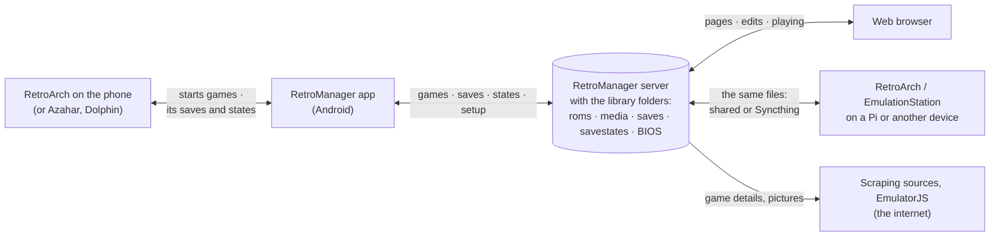

# RetroManager

A self-hosted web app for a retro game library kept in the EmulationStation layout: it manages `gamelist.xml` metadata and media, plays games in the browser, and has an Android app that plays them in RetroArch. It runs as a single Docker container on your own network.

> **No games or media included.** RetroManager is a tool for organising a library you already have. This project does not supply, link to or help obtain ROMs, BIOS files, disc images, or game artwork, screenshots or videos. Only use games you own and are legally allowed to copy where you live. Metadata and artwork downloaded through the scrapers come from the sources named in [CREDITS.md](CREDITS.md), under their own terms.
>
> **Games shown are for illustration only.** The game titles, box art, logos and screenshots that appear in this README's screenshots, and in any other picture of RetroManager here, are there only to show what the app does with a library. They belong to their publishers and owners, are not part of RetroManager, and are not included in, distributed with or obtainable through this project.

## AI Disclosure
This entire project has been created with Claude Code based on my own design and iterative feedback. If you are against AI coding...  I hate that I use it but it has enabled me to make tools that otherwise I wouldn't have the time to learn to build myself, so I'll live with my hypocrisy. AI for art is just bad though - don't do that.

## Quick start

```bash
git clone https://github.com/DeltaGemini/RetroManager.git
cd RetroManager
docker compose up -d
```

Then open `http://<this machine>:5000` from your own network (don't open the port to the internet: see [Keeping it safe](docs/setup.md#keeping-it-safe)). The first time, RetroManager shows where the library is and whether it can write there, and asks for a ScreenScraper account (with how to get one) or lets you skip that. Nothing has to be edited first: the library is a folder called `RetroGames` beside `docker-compose.yml` until you [point it at folders you already have](docs/setup.md#1-paths).

To run the published image instead of building it, put `image: ghcr.io/deltagemini/retromanager:latest` in place of `build: .` in `docker-compose.yml`. The Android app is in each [release](https://github.com/DeltaGemini/RetroManager/releases), and RetroManager offers it to phones itself (see [The Android app](docs/phone.md)).

## What it does

- **Library**: every system and game in an EmulationStation-style library, with each game's details, pictures, videos and manual. Edit them and they're written back to `gamelist.xml`, with a backup first. [More](docs/library.md)
- **Scraping**: fills in details and pictures from ScreenScraper, IGDB, RetroAchievements, TheGamesDB, SteamGridDB, LaunchBox, GameTDB, libretro and Steam, one game at a time or the whole library, recognising games by checksum. [More](docs/scraping.md)
- **Library health**: finds what's wrong (duplicates, missing entries, unlinked pictures, multi-disc games without a playlist, badly styled names) and fixes it. [More](docs/library.md#library-health)
- **Add games**: from a phone or PC, or a folder you've copied them to; it works out the system and files them. [More](docs/library.md#adding-games)
- **Console, Bookcase, Timeline**: the collection as a games console's home screen, a shelf of boxes, or one long timeline. [More](docs/console.md)
- **Play in the browser**: many systems play straight from the page, with your saves. [More](docs/console.md#playing-in-the-browser)
- **The Android app**: the Console on a phone, playing in the RetroArch already there, with saves and save states kept in step with the server, and offline play. [More](docs/phone.md)
- **Saves**: each game's saves and save states, Syncthing conflicts resolved, zipped backups, and a profile per person if you want one. [More](docs/library.md#saves-tool) · [Profiles](docs/profiles.md)
- **Achievements, play history, stats**: RetroAchievements progress, what's been played and when, and a dashboard tile. [More](docs/library.md)

## Documentation

| Page | What's in it |
|---|---|
| [Setting up](docs/setup.md) | Where the library goes, settings, running and updating, the folder layout, troubleshooting |
| [The Library and its tools](docs/library.md) | Browsing, editing and adding games; every tool under 🧰 Tools |
| [Scraping](docs/scraping.md) | The sources, what each gives, bulk and library scrapes, matching |
| [Console, Bookcase, Timeline and playing](docs/console.md) | The pages for looking through the collection, and playing in the browser |
| [The Android app](docs/phone.md) | Installing it, playing in RetroArch, saves, offline, controllers, shortcuts |
| [Profiles](docs/profiles.md) | A profile per person, sign-in, and telling RetroArch about them |
| [API](docs/api.md) | The HTTP API the pages use |
| [Developing and releasing](docs/development.md) | How it's built, where things are in the code, making a release |

## Screenshots

*These show a demo library of made-up games: every name, description and picture in them was invented and drawn by `tools/make_demo_library.py`, so they show no one else's games. No games of any kind are included with RetroManager.*

**Library**: systems, games and a game's details.


**Bookcase**: one shelf per system, each game's box spine out.


Click a box to take it off the shelf:


**Timeline**: every game by release year, or grouped by decade. Pick series to join their games with a line.


**Library health**: every system's scan in one table.


## How the parts fit together

RetroManager is the hub: one server, with the library's folders, that a browser, the Android app and RetroArch on your other devices all work from. Nothing talks to anything else directly; everything goes through the server or the folders it shares.



What moves, and when:

| Between | What | Which way | When |
|---|---|---|---|
| Browser and server | The pages, the library, your edits, pictures | Both | As you use it |
| | A game's file and BIOS, to play it in the browser | Server → browser | When you press Play |
| | Battery saves; the browser's own save states | Both | As you play |
| | RetroArch's save states, to carry on a Pi game in the browser, or the other way | Both | When you load one, or send one to the Pi |
| Phone app and server | The pages and game lists, kept on the phone | Server → phone | As they're opened; used when the server can't be reached |
| | Game files, BIOS, pictures and manuals (not videos) | Server → phone | When a game is fetched or played |
| | Battery saves and RetroArch save states, per person | Both | Before a game starts and when you come back from it, and every half hour or so in the background |
| | That a game was played (for Continue playing) | Phone → server | When it starts |
| | RetroArch's setup: core overrides, options, overlays | One phone → server → another | When you save or apply it |
| | The app itself, when there's a newer one | Server → phone | When the app opens |
| Phone app and RetroArch | Which game to start and with which core | App → RetroArch | When you press Play |
| | Which core ran a game, whether it started; save folders in a core's override (if you turn that on) | Both | Around each game |
| RetroArch elsewhere and the folders | Games, gamelists and pictures read; saves and states written | Both | Directly, as those devices play: the same files, shared or synced |
| Server and the internet | Game details, pictures, manuals and videos; a ROM's checksum to recognise it (Hasheous, can be turned off); EmulatorJS the first time a system is played in the browser | Mostly in | When you scrape, or play in the browser |

The phone never talks to RetroArch on another device, and games played in an emulator of their own (Azahar, Dolphin) keep their saves to themselves. Nothing leaves your network except what the scraping sources are asked, and the files fetched from them.

## Licence and credits

RetroManager is under the MIT licence ([LICENSE](LICENSE)). The artwork, fonts and layouts that come with it from other people, what it fetches when it's used, and the services it can ask are listed with their terms in [CREDITS.md](CREDITS.md). No games, BIOS files or media are supplied.
