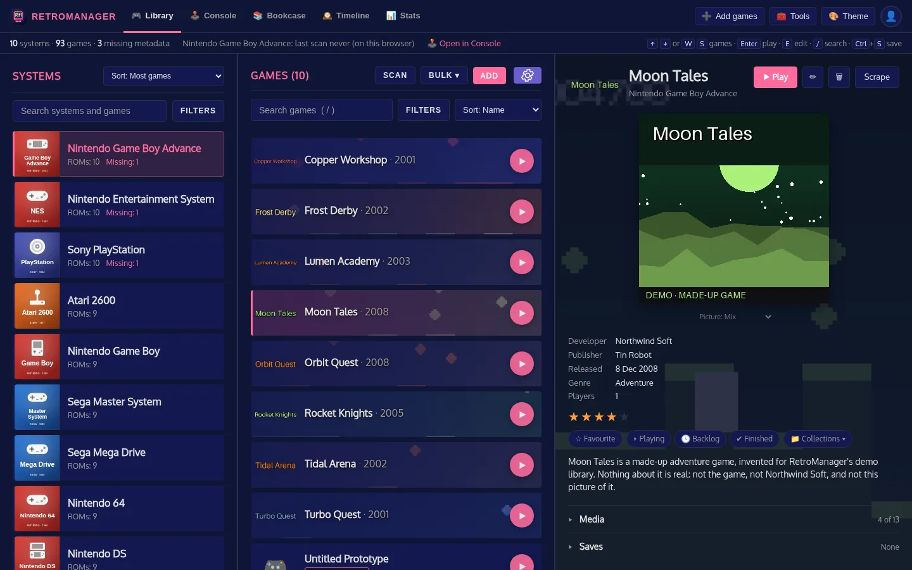
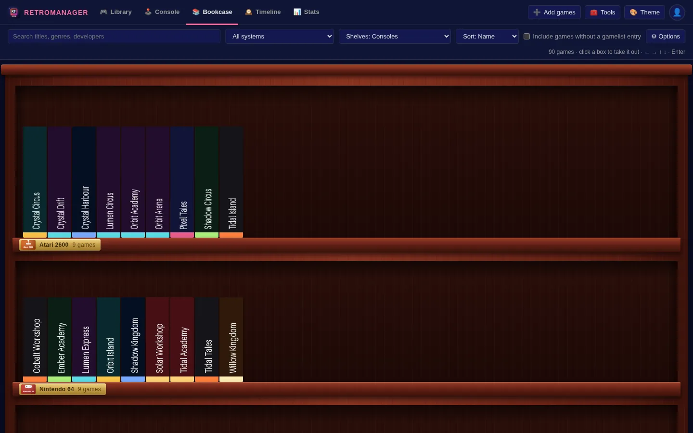
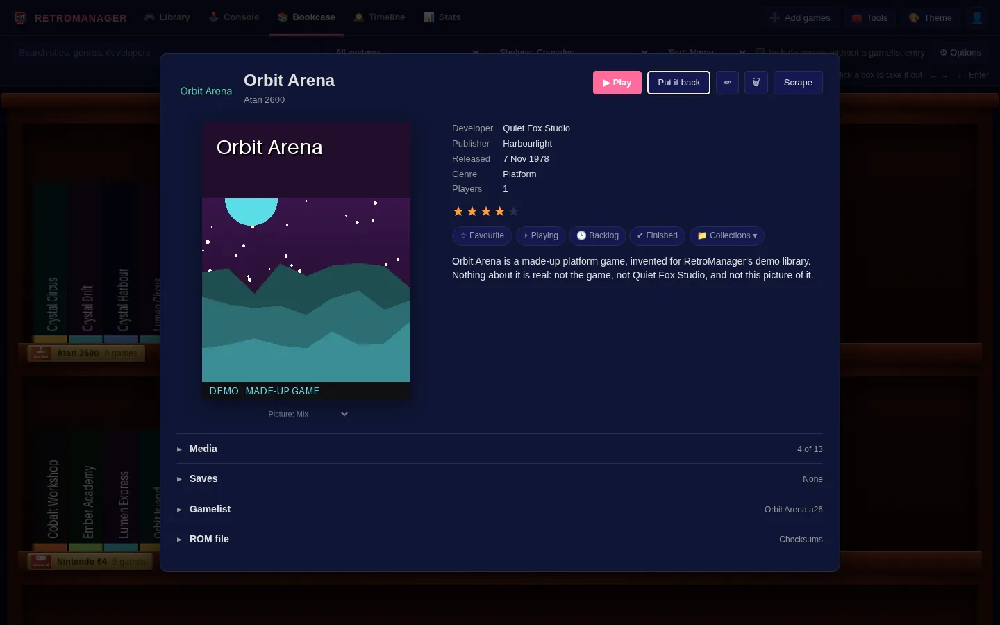
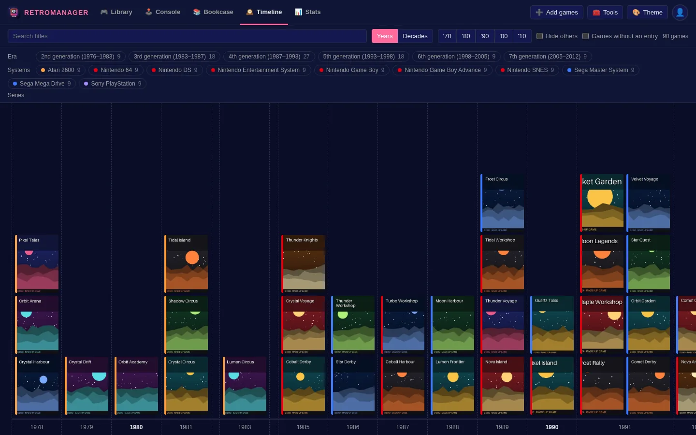
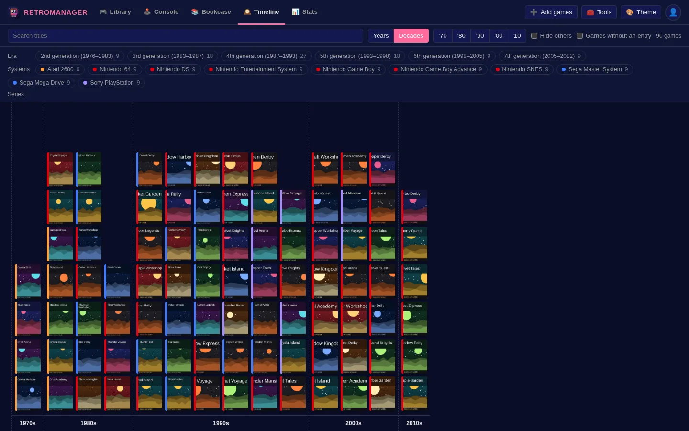
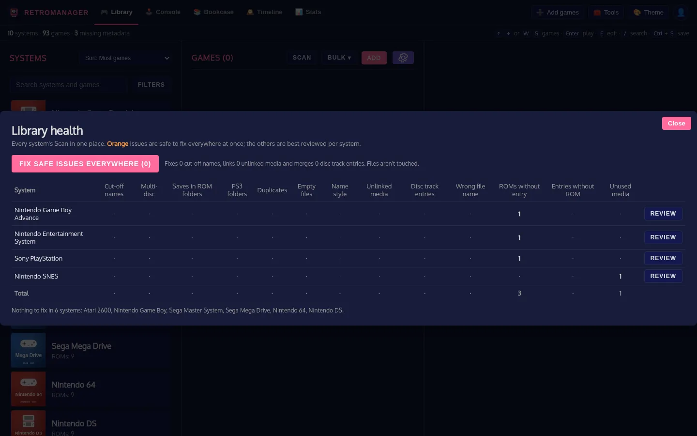
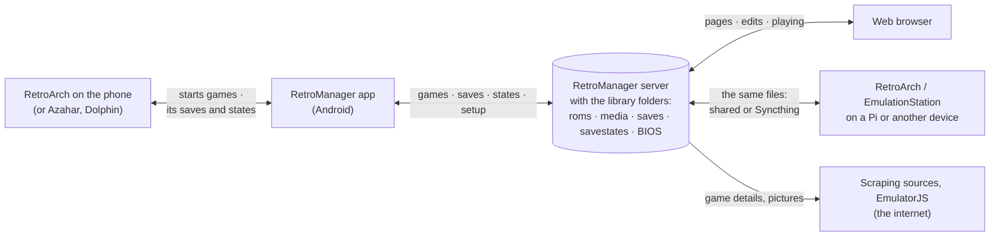

# RetroManager

A self-hosted web app for a retro game library kept in the EmulationStation layout: it manages `gamelist.xml` metadata and media, plays games in the browser, and has an Android app that plays them in RetroArch. It runs as a single Docker container on your own network.

> **No games or media included.** RetroManager is a tool for organising a library you already have. This project does not supply, link to or help obtain ROMs, BIOS files, disc images, or game artwork, screenshots or videos. Only use games you own and are legally allowed to copy where you live. Metadata and artwork downloaded through the scrapers come from the sources named in [CREDITS.md](CREDITS.md), under their own terms.
>
> **Games shown are for illustration only.** The game titles, box art, logos and screenshots that appear in this README's screenshots, and in any other picture of RetroManager here, are there only to show what the app does with a library. They belong to their publishers and owners, are not part of RetroManager, and are not included in, distributed with or obtainable through this project.

## AI Disclosure
This entire project has been created with Claude Code based on my own design and iterative feedback. If you are against AI coding...  I hate that I use it but it has enabled me to make tools that otherwise I wouldn't have the time to learn to build myself, so I'll live with my hypocrisy. AI for art is just bad though - don't do that.

## Quick start

```bash
git clone https://github.com/DeltaGemini/RetroManager.git
cd RetroManager
docker compose up -d
```

Then open `http://<this machine>:5000`. The first time, RetroManager shows where the library is and whether it can write there, and asks for a ScreenScraper account (with how to get one) or lets you skip that. Nothing has to be edited first: the library is a folder called `RetroGames` beside `docker-compose.yml` until you [point it at folders you already have](#1-paths).

To run the published image instead of building it, put `image: ghcr.io/deltagemini/retromanager:latest` in place of `build: .` in `docker-compose.yml`. The Android app is in each [release](https://github.com/DeltaGemini/RetroManager/releases), and RetroManager offers it to phones itself (see [On a phone](#on-a-phone)).

## Features

- **System discovery**: every folder under the ROMs mount is treated as a system. Nothing is hard-coded.
- **Missing metadata**: ROMs without a `gamelist.xml` entry are flagged per system and in the game list.
- **Metadata editing**: name, description, developer, publisher, genre, release date, players and rating.
- **Add games**: a wizard at `/import` for uploading games from a phone or PC (resumable), or adding what you've copied to the inbox folder: it groups the files, detects the system, identifies the game and files it in. See [Adding games](#adding-games).
- **Delete games**: removes the gamelist entry, and optionally the ROM file and its media (typing the name confirms).
- **Scan**: finds problems and offers a fix for each: multi-disc games without an `.m3u`, duplicate copies, cut-off or badly styled names, entries pointing at a mistyped ROM name (relink), media not linked in the gamelist, ROMs without an entry, entries without a ROM, and unused media. See [Scan](#scan).
- **One header on every page**: RetroManager, then **Library · Bookcase · Timeline · Stats**, then **➕ Add games**, **🧰 Tools** and the theme. The page's own controls sit in the row below it. While something runs in the background, a strip between the two shows [how far along it is](#background-tasks). Tools: [Library health](#library-health), [Library scrape](#library-scrape), [Missing media](#missing-media), [Achievement overview](#achievement-overview), [Play history](#play-history), [ROM check](#rom-check), [Saves](#saves-tool), [Gamelist backups](#gamelist-backups) and Settings.
- **Gamelist backups**: every change backs up `gamelist.xml` first; see what a backup would change and restore it.
- **Saves**: a game's saves and states per person, Syncthing conflict resolution, and zipped backups.
- **PC games**: DOS/Windows game folders count as one game each, with a choice of launch program.
- **Scraping**: search ScreenScraper, IGDB, RetroAchievements, Steam, SteamGridDB, TheGamesDB or libretro thumbnails, recognise ROMs by checksum, compare fields side by side, import selected fields and download artwork, one game at a time or in bulk. See [SCRAPING.md](SCRAPING.md).
- **Generate Mix pictures**: games without a Mix get one made from their own screenshot, box, cart or disc and logo; you review previews before anything is saved. See [Generating Mix pictures](#generating-mix-pictures).
- **Bookcase**: the collection as a bookcase at `/shelf`, one shelf per system. See [Bookcase](#bookcase).
- **Timeline**: every game on one timeline at `/timeline`, filtered by system or series. See [Timeline](#timeline).
- **Dashboard stats**: `/api/stats` feeds a Homepage dashboard tile. See [homepage-widget/README.md](homepage-widget/README.md).

## Screenshots

*These show a demo library of made-up games: every name, description and picture in them was invented and drawn by `tools/make_demo_library.py`, so they show no one else's games. No games of any kind are included with RetroManager.*

**Library**: systems, games and a game's details.



**Bookcase**: one shelf per system, each game's box spine out.



Click a box to take it off the shelf:



**Timeline**: every game by release year, or grouped by decade. Pick series to join their games with a line.





**Library health**: every system's scan in one table.



## How the parts fit together

RetroManager is the hub: one server, with the library's folders, that a browser, the Android app and RetroArch on your other devices all work from. Nothing talks to anything else directly; everything goes through the server or the folders it shares.



What moves, and when:

| Between | What | Which way | When |
|---|---|---|---|
| Browser and server | The pages, the library, your edits, pictures | Both | As you use it |
| | A game's file and BIOS, to play it in the browser | Server → browser | When you press Play |
| | Battery saves; the browser's own save states | Both | As you play |
| | RetroArch's save states, to carry on a Pi game in the browser, or the other way | Both | When you load one, or send one to the Pi |
| Phone app and server | The pages and game lists, kept on the phone | Server → phone | As they're opened; used when the server can't be reached |
| | Game files, BIOS, pictures and manuals (not videos) | Server → phone | When a game is fetched or played |
| | Battery saves and RetroArch save states, per person | Both | Before a game starts and when you come back from it, and every half hour or so in the background |
| | That a game was played (for Continue playing) | Phone → server | When it starts |
| | RetroArch's setup: core overrides, options, overlays | One phone → server → another | When you save or apply it |
| | The app itself, when there's a newer one | Server → phone | When the app opens |
| Phone app and RetroArch | Which game to start and with which core | App → RetroArch | When you press Play |
| | Which core ran a game, whether it started; save folders in a core's override (if you turn that on) | Both | Around each game |
| RetroArch elsewhere and the folders | Games, gamelists and pictures read; saves and states written | Both | Directly, as those devices play: the same files, shared or synced |
| Server and the internet | Game details, pictures, manuals and videos; a ROM's checksum to recognise it (Hasheous, can be turned off); EmulatorJS the first time a system is played in the browser | Mostly in | When you scrape, or play in the browser |

The phone never talks to RetroArch on another device, and games played in an emulator of their own (Azahar, Dolphin) keep their saves to themselves. Nothing leaves your network except what the scraping sources are asked, and the files fetched from them.

## Stack

| Part | Details |
|---|---|
| Backend | Python 3.11, Flask, lxml, requests (`backend/`) |
| Frontend | React 18 + Babel from a CDN, a single `frontend/index.html`, no build step |
| Storage | The filesystem: `gamelist.xml` in each ROM folder, media in the media mount. No database. |
| Deployment | One container, `docker compose`, port 5000 |

The frontend loads React and Babel from unpkg/jsDelivr, so the browser viewing the app needs internet access.

## Project layout

```
RetroManager/
├── backend/
│   ├── app.py               # Entry point: imports the route modules (gunicorn backend.app:app)
│   ├── core.py              # Configuration, the Flask app, shared clients and helpers
│   ├── routes/              # The API routes, one file per area (systems, games, scraping, saves...)
│   ├── scanner.py           # System/ROM discovery, media matching, scans
│   ├── gamelist_manager.py  # gamelist.xml read/write (atomic writes)
│   ├── models.py            # Game, System, MediaAsset, ScanResult
│   ├── scraper.py           # ScreenScraper client
│   ├── igdb_scraper.py      # IGDB client (Twitch OAuth)
│   ├── retroachievements.py # RetroAchievements client and its ROM checksums
│   ├── steam.py             # Steam store client (PC games)
│   ├── steamgriddb.py       # SteamGridDB client (artwork)
│   ├── thegamesdb.py        # TheGamesDB client (metadata and artwork)
│   ├── libretro_thumbs.py   # libretro thumbnails (artwork by ROM name)
│   ├── hasheous.py          # Hasheous: ROM checksum -> IDs on the other sources
│   ├── rom_hashes.py        # ROM checksums, remembered in DATA_PATH
│   ├── settings.py          # Accounts, keys and options set in Tools > Settings
│   ├── rom_index.py         # The ROM check: a checksum index of the library
│   ├── library_state.py     # Play status and collections
│   ├── maintenance.py       # Nightly housekeeping: data backups, the ROM check
│   ├── mix_generator.py     # Draws a Mix picture from a game's other media, to a template
│   ├── mix_jobs.py          # Mix inventory, previews in the background, commit, what was generated
│   ├── mix_templates/       # Mix layouts as JSON (classic.json), and each system's default
│   └── requirements.txt
├── frontend/
│   ├── index.html           # The library page: styles, and the list of script files it loads
│   ├── src/library/         # The library page's components (JSX), one file per area
│   ├── src/bookcase/        # The Bookcase page's components (shelf.html loads them)
│   ├── timeline.html, stats.html, import.html, play.html   # The other pages, each in one file
│   ├── src/common/          # The game list and the Game Details panel (and its editing) every page shares
│   ├── common/              # Shared by every page: header, each system's maker, kind and generation, series detection
│   ├── imgs/                # System artwork shown in the sidebar (from an EmulationStation theme: not for passing on)
│   ├── tiles/               # A drawn tile per system, used where imgs/ has no picture (tools/make_system_tiles.py)
│   └── favicon.ico
├── android/                 # The phone app: the Console page as a launcher for the phone's RetroArch (./build.sh)
├── homepage-widget/         # Dashboard widget experiments (see its README)
├── tools/build_frontend.js  # Run by the Dockerfile: compiles the pages and bundles React
├── tools/make_system_tiles.py  # Draws frontend/tiles/
├── tools/make_logo.py       # Draws frontend/open/retromanager-logo.svg
├── tools/make_icon.py       # Draws the app's icon and the tab's (frontend/icons/, favicon.ico)
├── tests/                   # pytest suite, on a throwaway library (no network): python -m pytest tests
├── Dockerfile
├── docker-compose.yml
├── dev-ssh.ps1              # Run a docker compose command on the Pi over SSH
├── test_igdb.py             # Manual IGDB smoke test (run inside the container)
├── SCRAPING.md
└── PROFILES.md              # Profiles: what they are, and setting RetroArch up for them
```

`frontend/scraperComponents.jsx` and `frontend/index 2.html` are old copies and aren't loaded by the app.

### System pictures, and a copy for others

Each system's picture is asked for as `/imgs/<folder>.jpg`. RetroManager has a tile of its own for every system in `frontend/tiles/`: a colour for its maker, a plain drawing of the kind of machine, its name and year, drawn by `tools/make_system_tiles.py` from shapes alone. **Those are what it shows**, by the folder's name, or the system that name is another for, or a plain "Games" one.

`frontend/imgs/` can also hold a picture per system from Lilbud's Switch-Light theme for EmulationStation. They are an optional extra under another licence (**CC BY-NC-SA**: credit, no commercial use, changed copies shared alike) and show the consoles' own logos; `frontend/imgs/README.md` has the credit and terms. **Tools › Settings › Appearance › System pictures** makes them the ones shown (a system the theme has no picture for keeps its tile), and anyone can choose either kind for their own browser or phone under **⚙ Console settings › System tiles show**, which is only there when the pictures are installed. A copy of RetroManager without `frontend/imgs/*.jpg` simply shows tiles throughout, and `SYSTEM_TILES=1` allows nothing else.

The Switch colour themes' background works that way too: the photograph this installation has isn't passed on (its source isn't recorded), and a copy without it shows a night sky drawn by `tools/make_background.py` (`frontend/open/background.svg`). The header's logo works the same way: the one in the Switch themes (lettered in a Sega logo font) gives way to `frontend/open/retromanager-logo.svg`, the name in blocks on a grid, drawn by `tools/make_logo.py` with no font, where the other isn't there or `OPEN_ARTWORK=1` is set. (The app's icon and the browser tab's are RetroManager's own already: a cartridge with RM on its label, drawn by `tools/make_icon.py`, which also makes `frontend/icons/icon-*.png` and `frontend/favicon.ico` from it.) To add or change a tile, edit `SYSTEMS` in the script and run it again.

## Licence and credits

RetroManager is under the MIT licence ([LICENSE](LICENSE)). The artwork, fonts and layouts that come with it from other people, what it fetches when it's used, and the services it can ask are listed with their terms in [CREDITS.md](CREDITS.md). No games, BIOS files or media are supplied.

### Making a release

`tools/export_public.sh <folder>` makes the copy that's given to others in another checkout (the public repository): everything that's in git here and nothing that isn't, plus the Android app as last built. Look over `git status` and `git diff` there, commit, and tag it (`v1.2.3`): the tag starts `.github/workflows/release.yml`, which builds the image for PCs and 64-bit Raspberry Pis, publishes it to `ghcr.io`, and makes a GitHub release with the app attached. The app is built and signed beforehand with `android/build.sh`, never in the workflow: its key stays with whoever makes the releases.

## Setup

### 1. Paths

With nothing set, the library is `RetroGames/` beside `docker-compose.yml`, made the first time it starts, with `roms/`, `media/` and the rest inside. That's all a new library needs.

To use folders you already have, copy `.env.example` to `.env` and set `RETRO_DIR` to the folder that holds `roms/`, `media/` and the rest on your machine. This is the one thing the first-run page can't do for you: which folders of the machine a container may see is decided where it's started. `docker-compose.yml` mounts everything from there:

```yaml
volumes:
  - ${RETRO_DIR:-./RetroGames}/roms:/roms
  - ${RETRO_DIR:-./RetroGames}/media:/media
```

Both mounts must be writable: the app writes `gamelist.xml`, backups, uploads and downloaded media.

**Folders in different places.** A folder that isn't inside `RETRO_DIR` (another share on a NAS, a different disk) has a setting of its own in `.env`, used instead of the one inside `RETRO_DIR`:

| In `.env` | Instead of | Holds |
|---|---|---|
| `ROMS_DIR` | `RETRO_DIR/roms` | The games, a folder per system, with each system's `gamelist.xml` |
| `MEDIA_DIR` | `RETRO_DIR/media` | Pictures, videos and manuals |
| `SAVES_DIR` | `RETRO_DIR/saves` | In-game saves, a folder per person |
| `SAVESTATES_DIR` | `RETRO_DIR/savestates` | Save states, a folder per person |
| `BIOS_DIR` | `RETRO_DIR/BIOS` | BIOS files (optional) |
| `INBOX_DIR` | `RETRO_DIR/inbox` | New games waiting to be added |
| `RETROMANAGER_DIR` | `RETRO_DIR/retromanager` | RetroManager's own files and settings |
| `SAVE_BACKUPS_DIR` | `RETRO_DIR/save-backups` | Save backups |

With every one of them set, `RETRO_DIR` isn't needed (set it to anything). `PORT` changes the port from 5000. After changing `.env`, run `docker compose up -d` again.

The saves mounts are optional. They're writable so [sync conflicts](#saves-tool) can be resolved (add `:ro` to only view saves), and `save-backups` holds zipped backups and the versions set aside when resolving conflicts:

```yaml
  - ${RETRO_DIR}/saves:/saves
  - ${RETRO_DIR}/savestates:/savestates
  - ${RETRO_DIR}/save-backups:/save-backups
  - ${RETRO_DIR}/inbox:/inbox
  - ${RETRO_DIR}/retromanager:/data
```

Syncthing shares all of `roms`, `media`, `saves` and `savestates`, so RetroManager keeps its own files in `retromanager`, `inbox` and `save-backups`, which aren't synced. Gamelist backups (`gamelist_<date>.xml`) and `media/<system>/_orphaned/` do sit in synced folders.

### 2. Configuration

All settings are environment variables in `docker-compose.yml`:

| Variable | Default | Purpose |
|---|---|---|
| `ROMS_PATH` | `/roms` | ROM root inside the container |
| `MEDIA_PATH` | `/media` | Media root inside the container |
| `SAVES_PATH` | `/saves` | In-game saves |
| `SAVESTATES_PATH` | `/savestates` | Save states |
| `SAVE_BACKUP_PATH` | `/save-backups` | Zipped save backups and set-aside conflict versions |
| `DATA_PATH` | `/data` | RetroManager's own files: library-scrape memory, duplicates moved aside. Keep it outside synced folders (falls back to `roms/.retromanager`) |
| `INBOX_PATH` | `/inbox` | Folder for new games to add; uploads are staged in its hidden `.uploads/` |
| `SAVE_PROFILES` | *(none)* | People to start with, each with a folder inside the two save folders, e.g. `alice,bob`. Usually left out: saves are shared until people are added in the app. See [PROFILES.md](PROFILES.md) |
| `NAME_STYLE_SERIES` | *(empty)* | Extra series names that get a colon after them in the Name style fix, comma separated |
| `MIX_WORKERS` | `2` | How many Mix previews are drawn at once (see [Generating Mix pictures](#generating-mix-pictures)) |
| `MIX_STAGING_HOURS` | `24` | How long Mix previews nobody committed are kept |

| `LOG_LEVEL` | `INFO` | How much the container logs (`DEBUG` also logs every request to a scraping source, addresses included) |

#### Accounts and keys

The scraping sources' accounts and keys aren't in `docker-compose.yml`. Set them in the app, in **🧰 Tools › Settings**:

- **ScreenScraper**: developer ID, password and debug password (they identify the software), and optionally your own user account. A user account is recommended: without it, requests count against the anonymous quota, and ScreenScraper shuts anonymous access off when its servers are busy.
- **IGDB**: a Twitch application's client ID and secret.
- **RetroAchievements**: your web API key, and the user whose earned achievements are shown.
- **SteamGridDB**: your API key.
- **TheGamesDB**: your API key (asked for on its forums).
- **Matching and media**: when libretro thumbnails are used in bulk and library scrapes, and whether ROMs are recognised by checksum through hasheous.org.

Settings take effect as soon as you save. They're kept in `settings.json` in `DATA_PATH` (`RetroGames/retromanager/`), readable only by the container's user. Saved passwords and keys are never sent back to the browser: the panel only says whether one is saved, and lets you replace or remove it. A source with nothing set is greyed out in the Scrape popup.

The old environment variables (`SCREENSCRAPER_LOGIN`, `IGDB_CLIENT_ID`, `RETROACHIEVEMENTS_API_KEY`...) still work as a starting value for anything not yet saved in Settings, so an older `docker-compose.yml` keeps working.

### 3. Build and run

```bash
docker compose up -d --build
```

Open `http://<NAS IP>:5000`.

### 4. Check it's up

```bash
curl http://localhost:5000/api/health
```

```json
{
  "status": "healthy",
  "roms_path": "/roms",
  "media_path": "/media",
  "roms_accessible": true,
  "media_accessible": true
}
```

### Updating

Code is copied into the image at build time, so rebuild after any change:

```bash
docker compose up -d --build
```

### Deploying to the Pi from Windows

`dev-ssh.ps1` runs a command in the project folder on the Pi. Copy `dev-ssh.example.ps1` to `dev-ssh.ps1` and put your host, port and folder in it (it isn't kept in git):

```powershell
.\dev-ssh.ps1 "docker compose up -d --build"
.\dev-ssh.ps1 "docker compose logs -f --tail 100"
```

## Folder structure

### ROMs

```
roms/
├── snes/
│   ├── gamelist.xml
│   └── Super Mario World (USA).sfc
└── psx/
    ├── gamelist.xml
    └── Final Fantasy VII (Disc 1).cue
```

Recognised ROM extensions are listed in `ROM_EXTENSIONS` in `backend/scanner.py`; `.zip` and `.7z` aren't included. A disc game is its `.cue`: the files a `.cue` names (its track `.bin` files), and any smaller `.cue` covering only some of them, count as parts of that one game. Likewise the discs an `.m3u` playlist lists are parts of the playlist's game.

**PC systems** (`dos`, `pc`, `winxp`, `scummvm`…, see `backend/folder_games.py`): each top-level folder with programs in it is one game, not every `.exe` inside. The game's launch file is the one its gamelist entry points at, or else the likeliest program: named like the folder, never setup, install, uninstall, DOSBox or config tools. Change it under **Launch file** in the game's details. The game is named after its folder. Folders without programs (a folder of disc images) keep each file as its own game.

**PS3**: a disc game is a folder (`PS3_GAME/`, `PS3_DISC.SFB`), not a file. Name the folder `<game>.ps3` and it is one game: RetroManager lists the folder as the ROM (`./Catherine (Europe).ps3`) and never looks inside, so its data files aren't taken for ROMs or saves, and media is named after the folder. Batocera and ES-DE use the same name, and RPCS3 opens the folder directly. A PS3 folder without the `.ps3` name is ignored until **Scan › Rename to .ps3** renames it. `.iso` games are ordinary files. Deleting a game from RetroManager never deletes a game folder.

### Media

```
media/
└── <media system folder>/
    └── <type>/
        └── <ROM file name without extension>.<ext>
```

Example: the box art for `roms/snes/Super Mario World (USA).sfc` is `media/Super Nintendo/box2d/Super Mario World (USA).png`.

- **Type folders the scanner reads**: `box2d`, `box3d`, `boxside`, `support` (the cartridge or disc), `wheel`, `screenshot`, `screenshottitle`, `fanart`, `posters`, `images`, `thumbnail`/`thumbnails`, `mix`, `manuals`, `videos`.
- **Matching**: files match on the ROM file name, ignoring case, or failing that on the same title with the `(region)`/`[version]` tags removed. Nothing looser is accepted, so a game with no matching file shows a placeholder rather than another game's art.
- **Media system folder**: the media folder doesn't need the same name as the ROM folder. The scanner resolves it in this order:
  1. Built-in aliases: `psx` → `Playstation`, `ps2` → `Playstation 2`, `ps3` → `Playstation 3`, `gc` → `Gamecube`, `snes` → `Super Nintendo`, `nds` → `Nintendo DS`, `n64` → `Nintendo 64`, `nsw` → `Nintendo Switch`, `pokemini` → `Pokémon mini`
  2. Exact or case-insensitive name
  3. Same name ignoring punctuation and spaces
  4. Initials (`gba` → `Game Boy Advance`)
  5. Substring
  6. Otherwise the ROM folder name itself

### gamelist.xml

Standard EmulationStation format. Writes are atomic, so a crash can't leave a half-written file.

```xml
<gameList>
  <game>
    <path>./Super Mario World (USA).sfc</path>
    <name>Super Mario World</name>
    <desc>...</desc>
    <image>../../media/Super Nintendo/images/Super Mario World (USA).png</image>
    <thumbnail>../../media/Super Nintendo/screenshottitle/Super Mario World (USA).png</thumbnail>
    <video>../../media/Super Nintendo/videos/Super Mario World (USA).mp4</video>
    <developer>Nintendo</developer>
    <publisher>Nintendo</publisher>
    <genre>Platform</genre>
    <releasedate>19901121T000000</releasedate>
    <players>1-2</players>
    <rating>0.85</rating>
  </game>
</gameList>
```

Release dates use `YYYYMMDDT000000`. Ratings are `0`–`1`.

EmulationStation only shows the media set in `<image>`, `<thumbnail>` and `<video>`; files in the media folders aren't enough on their own. RetroManager writes these as `../../media/<media system folder>/<type>/<file>` (`XML_MEDIA_PREFIX` in `backend/media_index.py`). EmulationStation reads them relative to the system's ROM folder, so from `roms/<system>/` they reach the `media/` folder beside `roms/`: `RetroGames/media` on the NAS (the one RetroManager mounts) and `~/RetroPie/media` on the Pi. Older `../media/...` paths are still read. `roms/media/` isn't used.

When they're empty, RetroManager fills them from the game's media in this order (`LINK_PREFERENCES` in `backend/media_index.py`):

| Field | Folders, first match wins |
|---|---|
| `image` | `images`, `mix`, `box2d`, `screenshot` |
| `thumbnail` | `screenshottitle`, `screenshot`, `box2d`, `wheel` |
| `video` | `videos` |

## Using it

1. Pick a system in the left sidebar. The count shows ROMs, and systems with missing metadata are highlighted. The header shows library totals and when this browser last scanned the system.
2. Pick a game. Games without a gamelist entry show a **Missing Metadata** badge. Region and version tags such as `(USA) (Rev 1)` are shown under the title.
3. The game's [details](#game-details) open. Click **✏** to change its name, facts, rating and description where they are, or **Scrape** to pull metadata and artwork from ScreenScraper or IGDB (see [SCRAPING.md](SCRAPING.md)).
4. Click **Save** to write `gamelist.xml`. Scraped fields aren't saved until you do this. **Preview the gamelist.xml entry** (under **Gamelist**) shows exactly what Save writes.

Each game card shows the game's screenshot (or its title screen) behind the name. **🎨 Theme** in the header picks the site's colours on every page: Midnight (the original dark), Daylight (the original light), Black, Slate, Terminal, Sepia, Switch and Switch Light. The choice is remembered in each browser. The two Switch themes follow the Switch Master EmulationStation theme: its colours, the Oxygen font, its logo in the header, hairlines under headings, a slim bar on the selected game and its star icons, and (Switch only) its background picture behind see-through panels. Their files, and their licence, are in `frontend/themes/switch/`. Themes are listed in `frontend/common/theme.js` and their colours are in `frontend/common/header.css`.

**Systems** (left): the search box finds systems and also games in every system (by name, developer or genre; click one to open it). **Filters** narrows the list by maker (Nintendo, Sega, Sony, Atari, computers) and type (consoles, handhelds, computers, arcade), to systems missing metadata, or shows empty systems. Sort by name, most games, most missing metadata, maker (grouped) or console generation (grouped with its years, oldest first: handhelds sit with the home consoles of their time, and arcade, computers and anything else follow; `SYSTEM_GENERATIONS` in `frontend/index.html`).

**Games** (middle): the search box matches name, file, description, genre, developer, publisher and series. **Filters** opens a panel: show only (missing metadata, ROM missing, no image, no description, favourites), series, genre, decade, region (from the file name's tags), missing media, players, minimum rating, developer and publisher. Within a filter any ticked option matches; different filters must all match. Filters in use show as chips under the search box; click one to remove it. Series, genre, developer and publisher filters clear when you change system; the rest stay. Sort by name, oldest or newest first, rating, developer, series or file name (remembered in the browser).

| Key | Does |
|---|---|
| `↑` `↓` | Previous / next game in the list (also from the search box) |
| `/` | Jump to the search box (`Esc` leaves it) |
| `Ctrl`+`S` / `⌘`+`S` | Save the open game |

**Delete** removes only the gamelist entry by default. You can also tick the ROM file and its media (files named exactly after the ROM); deleting files asks you to type the game's name first.

If you switch game or system with unsaved edits, RetroManager asks whether to save, discard or keep editing.

**Auto-fill** (under **Gamelist**, while editing) fills an empty Image, Thumbnail or Video from the game's media files. Applying scraped metadata does the same.

**+** (or **⟳**, to replace) on a tile in the **Media** section picks a file. It's saved straight away, without Save, into the media folder named after the ROM (like scraped media, replacing that game's file in another format), and linked where the gamelist's image, thumbnail or video used that media type. A replaced picture can't be brought back.

On phones the app goes systems → games → details, with **‹ Back** under the header; the phone's own Back gesture works too. The header shows icons, with the current page's name.

The header's row below shows library totals, when this browser last scanned the system, and the keyboard shortcuts. **🧰 Tools** works on every page: on the Bookcase or Timeline it opens the library with that tool (`/?tool=health`, `scrape`, `media`, `history`, `saves` or `backups`).

### Game details

A game looks the same wherever you open it: beside the Library's game list, on the Console page, and in the popup the Bookcase and the Timeline show (`frontend/src/common/game-details.jsx`).

- **At the top**: the name and system, **▶ Play** where the game runs in the browser, **📖 Manual** (read in place) when it has one, the page's own buttons, and for admins **✏** (edit), **🗑** (delete) and **Scrape**.
- **The picture** is the Mix image unless you change **Picture:** under it (2D box, 3D box, image, screenshot, title screen, fan art or poster). The choice is for every game on every page, kept in this browser; a game without that picture shows another one it has.
- **Beside it** (below it when the panel is narrow): developer, publisher, release date, genre, players, rating, the favourite star, play status and collections, then the description.
- **ROM file**, folded and last, has the file's name, what the [ROM check](#rom-check) made of it and its SHA-1, MD5 and CRC32, each with **Copy**. A disc game, which the ROM check doesn't hash, lists its `.cue` and every track instead, with **Work out the checksums** (each file is read whole, then the result is kept).
- **Series** (with IGDB set up) is a third such line: see [Missing in series](#missing-in-series).
- **Achievements** and **Saves** are one line each with a summary (`6 of 83 · 7%`, `3 files · latest 2 days ago`); click one to unfold it, and it stays that way for the next game.

**Editing happens in the panel itself**, on every page, for admins:

- **✏** turns the name, developer, publisher, release date, genre, players, rating and description into fields where they sit. **✏** and **🗑** become **Save** and **Cancel** until you're done. Leaving a game with unsaved changes asks first.
- **🗑** removes the game: its gamelist entry and, if you tick them, its ROM file and media (typing the name confirms).
- **Scrape** looks the game up and fills the fields for you to save. On the Console, Bookcase and Timeline it opens the game in the Library with the scraper ready.
- **Media** is a section like Saves: every picture, the manual and the video, each with **+** to add one or **⟳** to replace it.
- **Gamelist**, for admins, has what EmulationStation is told: which media the image, thumbnail and video use (changed while editing), a PC game's launch file, and a preview of the entry.

### Console

**🕹️ Console** in the header (or `/console`) shows the library the way a console does, after the Switch Master theme's system screen: rows of square tiles.

- **Continue playing**, first, is the dozen games played most recently (going by their saves and save states). Enter (or **A** on a controller) starts one straight away where the browser can play it; **E** (or **X**) opens its details instead, as a click does.
- **Recently added** is the dozen newest files.
- **Favourites and collections**: Favourites and each collection with games in it are tiles of their own, opening the same game screen as a system, with games from every system together. **🎲 Surprise me** beside them opens a game picked at random (one the browser can play, where there is one).
- **Systems**: big tiles in one row, or with **View** a row per console generation or per maker. **Sort** is the Library sidebar's. **Tiles** chooses which of a game's pictures its tile shows (the Mix, a box, the logo, a screenshot...), kept in this browser.

Left and right (arrow keys or A and D) move along a row, up and down (or W and S) between rows, and Enter or a click opens a tile. On a touch screen, putting a finger on a tile chooses it (so dragging a row along shows what's under your finger) and a tap opens it. The chosen tile's name is in a bubble under it: a game's with its console's picture, a system's or a list's with how many games it has. Pointing at a tile doesn't choose it, so moving the mouse across a row doesn't send it scrolling.

**A game controller** works on this page: the D-pad or left stick moves, **A** opens or plays, **B** goes back, **X** edits (or shows a recent game's details), the shoulder buttons page through a game list and Start plays. The line at the bottom shows the controller's buttons once one is connected (press a button on it first: browsers only notice a controller then).

A system opens on the same game list the Library has (each game's logo over its screenshot, with search, **Filters** and **Sort**), beside the chosen game's [details](#game-details). It's for browsing and playing, so it has none of the Library's Scan, Bulk or Add; a game is edited in its details (✏, or E), and the Library's **🕹️ Open in Console** comes back. The address follows what's open (`/console?system=<folder>&game=<rom path>`). On a phone the list and the details take turns.

**The game list's keys**, on both pages: up and down (arrow keys or W and S) choose a game, Page Up, Page Down, Home and End jump, Enter plays it in the browser where that's possible (otherwise it opens it for editing), **E** edits it, `/` jumps to the search box. In Console, Esc, Backspace or left goes back to the systems. Each game the browser can play has a round **▶** button at the right of its row, which starts it straight away.


### On a phone, with its own RetroArch

`android/` is a small Android app that shows the Console page and starts games in the RetroArch already installed on the phone, with the cores installed there. It's the same page, served by RetroManager, so the tiles, lists, details, profiles and themes are as they are in a browser. In the app the Console is the only view: the header has no other pages, Add games or Tools (a link to the Library comes back to the Console), and shows whether RetroManager can be reached (**Online**, or **Offline** in amber). Pressing **Offline** looks for it again there and then; if it still isn't there and Tailscale is installed, it offers to start Tailscale (or open it), and reloads once RetroManager answers.

**Building it** needs the Android SDK (build-tools and a platform) and a JDK, nothing else: `android/build.sh` makes `android/build/RetroManager.apk`, and `android/build.sh install` also installs it on a phone plugged in with USB debugging on. It's signed with a key made the first time (`android/debug.keystore`): keep that file, since an update must be signed with the same key. The app is signed with a key of the builder's own, which is never in the repository: with no `android/signing.env`, one is made the first time (`android/debug.keystore`), which is all a phone of your own needs. To build the app for other people, keep a key and its password to yourself and name them in `android/signing.env` (`KEYSTORE=`, `KEY_ALIAS=`, `KEYSTORE_PASS=`; the script's comments show it), and keep copies of both somewhere safe: an update only installs over the app if it's signed with the same key, so a lost key means everyone has to remove the app and install it afresh.

**📱 This phone** in the header is the app's settings, drawn by the page in its own colours: **Connection** (RetroManager's address, whether it's reached, opening it in the browser, reloading), **RetroArch** (its folder, which RetroArch app, and **Emulators**), **Saves and save states** (whose, with login off), **Storage** (**Games on this phone**, and the pages kept for offline), **Library** (for an admin: **Add games**, the wizard, with the phone's file picker; the app is also in the phone's share menu as **Add to RetroManager**, so a file downloaded in another app can be shared straight into the wizard, over plain `http` too), **Console** (which of a game's pictures its tile shows: the Mix, a box, the logo, a screenshot...), **Colours** (the themes, which is where they are in the app) and **About** (the app's version, and looking for a newer one). The phone's Back steps out of each screen.

The app's questions and messages (a save that differs, a core that didn't start, taking a game off the phone, how a fetch is going) are drawn by the page too, in the theme's colours. Only while there's no page of RetroManager's to draw them (setting up, or a page that couldn't be reached) are they the phone's own boxes; the folder picker is always Android's.

**Setting up** (asked once; both are under **📱 This phone** afterwards):

1. RetroManager's address, as you'd type it in a browser (`http://192.168.1.10:5000`).
2. RetroArch's folder on the phone (usually `RetroArch` in the phone's storage). The app is given that folder only, through Android's folder picker. Inside it: `roms/<system>/` holds the games, under the same folder and file names as on the server; `media/<system>/<type>/` the pictures; and `saves/` is RetroArch's own.

**Playing:** ▶ looks the game up, fetches whichever of its files the phone's `roms` folder hasn't got (a disc's tracks and a playlist's discs with it; a box shows how far along it is, with Cancel), the system's BIOS files if RetroArch's `system` folder hasn't got them (from `BIOS_PATH`), and starts RetroArch on it. A fetch that's cut off carries on from where it got to the next time, and goes on behind other apps (there's a notification while it does). A file the app fetched itself is fetched again if the server's has changed since; one that got there another way is left alone.

**Fetching without playing:** **⬇ Fetch** in a game's details brings it to the phone for later. Over a list, **⬇ Fetch the N not here** does that for every game listed that the phone hasn't got: a system, Favourites, a collection, or whatever the search and filters leave (it asks first). A game that's there already, copied or kept in step by something like Syncthing, starts at once: a file of the right name is taken as the game. While a file arrives it's named `.syncthing.<name>.tmp`, which Syncthing never sends on.

**A game's page** starts with **▶ Play** across it and **⋯** beside it, which holds the rest: Add to the home screen, Emulator, Manual, Remove from this phone, and for an admin Edit and Delete.

**What's on the phone:** a system's tile says how many of its games are on the phone (📱 12), as does its bubble. A game that's there has 📱 in the list and a filled ▶; one the phone has to fetch first has an outlined ⬇ (**⬇ Fetch and play** in its details). **📱 On this phone** over the list leaves only the phone's games. With no connection, the games that aren't on the phone stay listed but greyed, with nothing to start them, and the systems with none are greyed and come last.

**What's taking the room:** **📱 This phone → Games on this phone…** lists each system's files in the `roms` folder with their size, the total and what's free; a system opens on its files, largest first, and pressing one offers to take that game off the phone.

**The same RetroArch setup on another phone.** RetroArch's main settings file is out of any app's reach, but its `config` folder isn't, and that's where a core's overrides, options, remaps and shader presets are. Under **📱 This phone › RetroArch setup**:

- **Save this phone's setup** (an admin) sends everything in `config`, and the folders of any overlays its overrides name, to RetroManager (kept in `retroarch-setup/` in the data folder). **Apply the saved setup** on another phone fetches them into the same places, putting right any path that names the first phone's folders. A file of the phone's own that differs is kept in `RetroArch/RetroManager backups/setup-<when>/` first. One of RetroArch's own overlays is in its private storage, the same on every phone, so only the override that names it needs carrying.
- **Same save folders on every phone** has the app write where saves go into the override of each core it starts: `saves/<system>/` and `states/<system>/` in the RetroArch folder, whatever RetroArch itself is set to. Whatever else the override says is kept. It needs RetroArch's own name for the core's folder (`_RETROARCH_CORE_NAMES` in `backend/systems.py`); a core that isn't there is left alone.
- **Check this phone** says what the app can see: RetroArch and its folders, the cores it has played with, where saves have been going, and which setup is kept.

**Taking a game off the phone:** **📱 Remove from phone** in the details of a game that's there deletes its files from the phone's `roms` folder, after saying how many and how big (and, if the folder is one Syncthing keeps in step, that the removal may be carried to the other device, or undone). The game stays in RetroManager and its save stays on the phone. It isn't the 🗑, which deletes the game from the library.

**On the home screen:** **📌 Home screen** in a game's details puts the game on the phone's home screen (the phone asks first). If the game has more than one picture, it asks which to make the icon from: the box, the Mix, the logo, a screenshot and so on. For a game that's on the phone and played in RetroArch, the icon starts RetroArch on it directly, without the app opening first. The app isn't there to carry the save then, so the game's save and save states are sent to RetroManager the next time the app is opened (a newer one on the server is only fetched when the game is started from the app). A game that isn't on the phone yet, or is played in an emulator of its own, has an icon that opens the app, which fetches it or hands it over; such icons are pointed straight at RetroArch, when they can be, each time the app opens.

**What plays a system:** RetroArch with one of its cores, or for some systems an emulator of its own (so far Azahar for the 3DS, and Dolphin for the GameCube and Wii). RetroManager lists them per system (`_RETROARCH_CORES`, `_PHONE_EMULATORS` and `_PHONE_EMULATOR_SYSTEMS` in `backend/systems.py`); the app chooses among the ones on the phone. It can see which emulator apps are installed, but not which cores RetroArch has, so for those it goes by RetroArch's history (in its folder), which names the core each game was played with. In order: what you chose; the core RetroArch last played the system's games with; an installed emulator of its own; a core RetroArch has played anything with; a core that hasn't been tried.

- **A core that isn't installed:** when you come back from RetroArch and the game isn't in its history, it didn't start. That core is passed over from then on, and you're asked what to do: try the next one, open RetroArch to install the core (Online Updater → Core Downloader), or choose yourself. (If RetroArch's history is turned off, say **It did start: don't ask again**.)
- **Nothing to play it with:** the system's tile says **⚠ No emulator** and its games **⚠ Needs an emulator**; pressing that says what's missing, with a link to the emulator or a way into RetroArch.
- **🎛 Emulator** in a game's details chooses for that game alone, over what its system is played with.
- **📱 This phone → Emulators…** shows what each system is played with, and lets you choose: any of its cores (marked installed, or that it didn't start), an emulator of its own (or where to get it), or a core you name.
- A 3DS `.cia` has to be installed in Azahar before it plays (Azahar's **Install CIA file**). The app reads which title the file is and starts the installed copy, or says it needs installing and opens Azahar. For that, Azahar's own folder has to be inside the RetroArch folder (`azahar/`), where the app can look. A `.3ds` or `.cci` game starts as it is.
- An emulator of its own is handed the game as a document it may read, and keeps its saves to itself: only RetroArch's are carried to and from the server.

**The first screen in the app** has a row of **Installed games**: the games that are on the phone, the ones played lately first and then by name (the first 60, with the count in the row's name when there are more). The **⚙** beside the search, in the app and in a browser alike, opens **Console settings**: which of the rows show (Continue playing, Recently added and, in the app, Installed games), which of a game's pictures its tile shows, whether the systems show RetroManager's own drawn tiles or the Switch theme's pictures, where those are installed (on the Library and Bookcase pages too), how the systems are sorted, and whether they're one row or grouped by generation or maker. Each is remembered by the browser or phone it was chosen on.

**A controller** (a grip the phone sits in, or one paired over Bluetooth) works the app as it does the Console page in a browser: the D-pad or left stick chooses, **A** opens a system or plays the chosen game (fetching it first if it isn't on the phone), **B** goes back, **X** shows the chosen game's page, **L1** and **R1** page through a list. In a game list the stick moves down the list without opening each game; on a game's page **A** plays it. Questions the app asks and its menus are answered the same way: up and down choose, **A** presses, **B** closes.

**Saves** are the same battery saves the Pi and the browser use, per person. With login on they're the signed-in person's; with it off the app asks once whose (or nobody's). Before a game starts, whichever of the phone's save and the server's has changed since they last matched replaces the other; if both have, you're asked which to play, and the one replaced is kept (the server's in the save backups folder, the phone's in `saves/RetroManager backups/`). When you come back from RetroArch, a changed save is sent to the server. About every half hour while the app is closed, with a connection, it looks again in the background and sends what has changed (saves and save states), so a game left with the Home button or started from its home-screen icon is carried too; Android decides exactly when, and may hold it back to save battery. The save is looked for where RetroArch puts it: `saves/`, a folder inside it (sorted by core or system), or beside the game. 

**More than one person on a phone:** RetroArch keeps one save (and one set of save states) for a game, whoever is playing, so the app notes whose are on the phone. When a game is started by someone else (another person signed in, or chosen in the app's settings), the save and states that are there are put by for the person they belong to, in `saves/RetroManager people/<name>/` and `states/RetroManager people/<name>/`, and the new person's own are brought back from theirs, or fetched from the server, or the game starts afresh if they have none. Nothing of one person's is sent to the server as another's. A put-by save that had changes not yet sent still goes up for its own person; put-by save states wait until that person next starts the game. A game started from its home-screen icon doesn't pass through the app, so it plays whichever person's save is on the phone. Saves that were on the phone before the app had anything to do with them (put there by Syncthing, or played in RetroArch on its own) aren't taken to be whoever starts the game first: with more than one person on the server, the app asks once whose they are. **📱 This phone › The saves on this phone are** shows the answer and changes it; choosing a name there also takes every save on the phone now to be that person's, which is how to put it right if someone's saves were sent as another's.

**Save states** are carried too, both ways: RetroArch's own, slot by slot and the auto state, for the same person. Before a game starts and when you come back from it, whichever of the phone's and the server's has changed since they last matched replaces the other (the server's replaced one goes to the save backups folder under `phone-play/`, the phone's to `states/RetroManager backups/`). Where both have changed, the app shows each one's date and asks which to keep, or to leave both; it only asks when a game is being started. A state made by a different core from the one the phone plays the game with isn't fetched, since it wouldn't load (the server tells the core from how the state starts: `_STATE_CORES` in `backend/routes/play.py`); one from a newer version of the same core may not load either, which RetroArch says when it's tried. States over 64 MB are left where they are.

**Pictures with the game:** the first time a game is started from the phone, its pictures and manual are fetched to the phone's `media` folder behind the game, so its page is whole with no connection. Not its videos.

**With no connection:** every page, game list and picture the app has shown is kept on the phone, and shown again when RetroManager can't be reached, as it was then (pictures in the `media` folder, where ones already there are used without asking the server; the rest in the app's own storage). A game on the phone still starts, and its save goes to the server the next time the app is open with a connection. A page never opened on the phone says so. A favourite or a play status set with no connection is kept on the phone and sent when RetroManager is back, and shows as set meanwhile; other changes need the connection.

**What's been played:** the app tells RetroManager when it starts a game (later, if there's no connection), so a game played on the phone is in **Continue playing** even if it never wrote a save.

**Search:** the box over the systems looks through every system's games at once (by name, developer or genre) and opens the ones found as a list.

**Updating the app:** `android/build.sh` also puts the build in `frontend/app/` (not in the repository), which goes into the image the next time that's built. The app asks RetroManager for its number (`/app/version.json`) when it opens and offers a newer one, which downloads in the phone's browser and installs over the old one; **📱 This phone → App version** asks again. Each build's version is the time it was made.

**Limits:** it wants RetroArch from retroarch.com (`com.retroarch.aarch64`; the Play Store builds can't read as much of the phone's storage), which must be able to read the RetroArch folder itself; and a folder on the phone's own storage or SD card. Over plain `http` the phone has to be on the same network as RetroManager, as with a browser.

### Profiles and login

RetroManager starts with **no profiles**: one set of saves, favourites and play statuses, shared by everyone, with games played on the saves RetroArch already keeps. The profile button is in the header all the same (a plain 👤): its menu has **Profiles and login**, where people are added. Adding one asks whether the saves there are already stay shared or move to that person. A profile's saves live in a folder of its own, which RetroArch has to be told to use: [PROFILES.md](PROFILES.md) goes through that, with the [RetroPie profiles](https://github.com/DeltaGemini/retropie_profiles) switcher for EmulationStation.

Off to begin with: everyone shares one set of everything and anyone can change anything. **🧰 Tools › Profiles and login** sets it up.

- **Profiles** are the people the saves folders are for (`saves/<name>/`, `savestates/<name>/`); to begin with, the names in `SAVE_PROFILES`. Each has a photo (click the round picture to choose one), and a role: **admin** or **player**. **Add a profile** makes a new person and their folders.
- **Switching login on** needs an admin with a PIN (4 to 8 digits). The device you do it on is signed in as that admin, and the play statuses and want list kept until then become theirs.
- **Signing in.** A device with nobody signed in shows **Who's playing?**: a player taps their photo; an admin's asks for the PIN. The device stays signed in (for over a year) until someone switches or signs out. The photo at the right of the header switches profile: a player's with one click, an admin's by asking for the PIN, every time.
- **What's a person's own:** play status, the want list and hidden platforms in Missing in series, achievements (where their RetroAchievements account is in Settings), Continue playing on the Console page, which save the play page uses, and preferences (theme, sort orders, the details picture, touch layouts...), which follow them to another device. **Shared:** favourites (which any signed-in person can set, as EmulationStation shows them) and collections (which an admin edits).
- **What only an admin can do:** edit, scrape, delete and add games, Scan and its fixes, the ROM check's fixes, backups, Settings, collections, series matching, and profiles. A player isn't shown those, and the server refuses them whatever asks. A player's saves and save states are their own: the play page can't read or write another person's.
- **A forgotten PIN:** put an empty file called `reset-login` in RetroManager's data folder. Login switches itself off and the file is removed; set a new PIN and switch it on again.
- PINs are kept hashed, in `accounts.json` in the data folder (in the nightly data backup), with the photos in `profiles/` (`backend/accounts.py`). Signing in is a signed cookie. This guards against a slip of the hand at home, not an attacker: players have no PIN, and over plain HTTP a PIN could be read by someone else on the network. For access from outside, keep it behind a VPN.

### Housekeeping

Every night (after 3 a.m., server time) RetroManager backs up its own data (settings, play statuses and collections, the ROM check's results, what scraping has already looked at) to `RetroGames/retromanager/backups/`, keeping the latest 14, and runs the ROM check on new and changed files. **Settings** shows the latest backup and has **Back up now**. The backups hold the same passwords and keys as the settings. A library scrape or ROM check cut short by a restart starts again by itself.

### Bookcase

**📚 Bookcase** in the header (or `/shelf`) shows the collection as a bookcase, one shelf per system (or per franchise, generation or manufacturer), without changing the library page.

- **Boxes** are sized like the real box or case for that system (`BOX_SIZES` in `frontend/shelf.html`), so SNES boxes stand tall and PlayStation jewel cases are short and thin. Thin cases (DVD-style cases for PS2, GameCube, Wii, PS3 and PSP, plus DS, 3DS, PlayStation and Switch) are drawn larger than life, in proportion, until the spine is wide enough to read the game's name (`READABLE_SPINE_PX`), up to 1.5 times their real size.
- **Shelves** (remembered in this browser) chooses what each shelf holds:
  - **Consoles**: one per system, in name order. A console's nameplate is a link that opens it in the Library. **Consoles by generation** puts them in generation order with a heading over each.
  - **Franchises**: one per series (the Timeline's series, from the part of the name before the colon), in name order, then **Other games** for everything that isn't in one.
  - **Generations**: one per console generation, then Arcade, Computers and Other.
  - **Manufacturers**: Nintendo, Sega, Sony, Atari, Computers, Other.

  A shelf that mixes systems keeps each box its own size. Generation and manufacturer shelves keep each system's games together; a franchise's shelf runs in the chosen sort order (**Sort: Year** puts a series in release order). Generations and manufacturers are the Library's (`frontend/common/systems.js`); series detection is `frontend/common/series.js`.
- **Spines** use the game's `boxside` image. Download spines with the **Spine** media type in single or bulk scraping (ScreenScraper `box-2D-side`). Without one, the spine shows the left edge of the cover with the title down it.
- **Hover** (or keyboard focus) turns the box to face you: it widens to its Box 2D cover, the boxes beside it slide over to make room, and the game's name and year show underneath. Boxes without a cover enlarge the spine instead.
- **Click** (or tap, or Enter) pulls the box out: it slides up out of the shelf, leaving a gap, and swings towards you. Then the game's [details](#game-details) open in a popup. **Put it back** (or Esc) slides it back into its gap. With reduced motion switched on, the card opens straight away.
- **Keyboard:** ← → along a shelf, ↑ ↓ between shelves, Enter opens.
- **⚙ Options › Bookcase** changes what the bookcase is made of: Mahogany, Oak, Walnut, Ebony, White, Neon arcade or Frosted glass (see-through panes over a blurred wash of the site theme's colours). It's separate from the site theme, and remembered in this browser.
- Shelves are in system-name order. Pick one system from the system menu (remembered in the browser), or show all.
- Search dims boxes that don't match and hides shelves with none. By default only games with a gamelist entry are shown.

- **⚙ Options** (remembered in the browser):
  - **Preload pictures:** fetches every shown game's cover (the hover picture) and details picture in the background, 4 at a time, with progress in the menu, so hovering and opening are instant.

Images are served as small WebP thumbnails, made on first use and kept in `THUMB_DIR` (`/data/thumbs` in docker-compose.yml, so they survive rebuilds). Their addresses carry the source file's change time, so browsers keep them for a year and still pick up new art straight away.

### Adding games

**➕ Add games** in the header (or **Add** in the game list, or `/import`) opens a three-step wizard that works on a phone as well as a PC:

1. **Choose files.**
   - **From this device:** pick or drop files. They upload in 8 MB pieces with a progress bar; if the connection drops, the upload retries and carries on where it stopped (choosing the same file again later resumes it too). The screen is kept awake while uploading where the browser allows.
   - **From the inbox folder:** anything copied to `RetroGames/inbox` on the NAS (over the network, Syncthing...). Put games in a folder named after the system (`inbox/snes/`) to skip choosing it.
2. **Check details**, one card per game:
   - **Grouping:** a `.cue` and the tracks it names are one game (missing tracks are pointed out); several discs of one game become one game with an `.m3u` playlist.
   - **System:** from the file extension, or for disc images (`.iso`, `.bin`, `.chd`…) from markers inside the file (GameCube, Wii, PlayStation 1/2, PSP, Saturn, Sega CD, PC Engine CD). Only systems you have folders for are offered.
   - **Match:** ScreenScraper looks the file up by name, size and MD5 checksum (files up to 1 GB), so a known dump is an **Exact** match whatever it's called. Exact and Likely matches are picked; search another name, or choose **Don't scrape**.
   - **Name:** ScreenScraper's (put in your house style), or type your own.
   - **Warnings:** games that look like ones already in the library, and files that already exist in the system folder (those can't be added).
3. **Add:** moves the files into `roms/<system>/` with their own file names, adds the gamelist entry, and fills it from the match: empty fields, media (choose which; videos aren't offered) and Image/Thumbnail links. The games then show in the library, Bookcase and Timeline.

Uploads are staged in `inbox/.uploads/` rather than under `roms/`, so half-finished files don't sync to other devices. Unzip archives before adding them. PC game folders (DOS) are best copied to `roms/dos/` directly, then added with Scan.

**Share to RetroManager:** RetroManager can be installed as an app (it has a web app manifest and service worker). Installed on Android, it appears in the share menu, so a downloaded ROM can be shared straight into the wizard. Browsers only allow installing and sharing on **HTTPS**, so this starts working once RetroManager is behind a secure address (for example a reverse proxy with a certificate); over plain `http://` the wizard works the same, you just pick files inside it.

### Timeline

**🕰️ Timeline** in the header (or `/timeline`) puts every game on one timeline by release year, as covers with a coloured edge for the system family (Nintendo, Sega, Sony, computers, Atari).

- **Layout:** each year's covers stack up from the axis and spill into more piles to the right, so the page stays one screen tall and scrolls sideways (the mouse wheel scrolls it too). Years without games are thin gaps. **Decades** switches to smaller covers grouped by decade; the **'90 '00 …** buttons jump along. Games without a release year sit in an **Unknown** column at the end.
- **Filters:** tick console generations (**Era**), systems and series; everything else fades (or disappears, with **Hide others**). Search works the same way. Filters are kept in the address, so a view can be bookmarked (`/timeline?gens=5&series=star wars&systems=n64`).
- **Series** come from the part of the name before the colon, so house-style names group themselves: `Star Wars: Rogue Squadron` is in *Star Wars*. Sequel numbers come off (`Castlevania II: …` is *Castlevania*), and names without a colon join a series they start with (`Pokémon Snap` is in *Pokémon*). A series needs two games; the twelve biggest are shown, **All series** lists the rest.
- **Series line:** a picked series is joined by a line in release order, each cover numbered, and the timeline scrolls to its first game. Several series get a line each, in different colours.
- **Hover** shows the name, year and system; **click** opens the game's [details](#game-details) in a popup.
- By default only games with a gamelist entry are shown.

### Library health

**🧰 Tools › Library health** runs every system's Scan at once (a few seconds) and shows a table of issues per system. **Review** opens that system with its Scan panel.

**Fix safe issues everywhere** runs only the fixes that can't lose anything, across all systems: **Fix names**, **Link media** and **Merge into disc**. Each system's gamelist is backed up first. Relinking, creating or removing entries, renaming, duplicates, multi-disc playlists and moving unused media stay per system, in the Scan panel, where you review them.

### Library scrape

**🧰 Tools › Library scrape** scrapes every system from ScreenScraper (with the checksum and libretro fallbacks described in [SCRAPING.md](SCRAPING.md#bulk-scraping)) in the background, one game at a time; close the panel and keep working (the [strip under the header](#background-tasks), on every page, shows progress and reopens it).

- **Which games:** every game missing metadata, and optionally games with metadata that lack any of the chosen media types.
- **Confident matches** (ScreenScraper recognised the ROM file, or the name matches closely) are applied like Bulk scrape: empty fields only, and only media the game doesn't have yet. Each gamelist is backed up before its first change.
- **Uncertain matches** and misses are listed under **Needs a look** with the best guess; **Open** takes you to the game to scrape it by hand.
- Checked games are remembered in `RetroGames/retromanager/scrape-queue.json` and skipped for 30 days, so reruns don't spend the ScreenScraper quota again (tick **Recheck** to include them).
- Quota or login errors stop the run with the reason.

### Background tasks

While the library scrape, the ROM check or series matching is running, a strip appears under the header on every page: the task's name, a progress bar, how far along it is and what it's working on now. Click it to open that task's tool (where **Stop** is). With more than one running, the strip shows one and **+1 more** unfolds the rest. When a task ends the strip says how it went (`49 filled, 9 to review`, or why it stopped) for most of a minute, then goes; with nothing running it takes no room. It's shown to admins.

Work that runs in the browser tab rather than on the server (Bulk scrape, uploads on the Add games page, Mix previews) isn't in it: that stops when you leave the page.

### Missing media

**🧰 Tools › Missing media** counts, per system, the games missing each media type. Click a system for a grid of its games missing the chosen type (or any), linking to each game. **Scrape … for these** starts a library scrape of that system for that media. Pictures ScreenScraper, libretro and IGDB don't have are then looked for at GameTDB (discs and cartridges), LaunchBox (if it's turned on in Settings), TheGamesDB and SteamGridDB (if their keys are set) (see [SCRAPING.md](SCRAPING.md#bulk-scraping)).

### Generating Mix pictures

A game without a Mix picture can have one made from the media it does have: its screenshot, box, cartridge or disc, and logo, laid out like the Mix pictures scrapers make. Nothing is fetched and nothing is invented; it only arranges pictures already in the media folders.

In **🧰 Tools › Missing media**, open a system and choose **Mix**. Tick the games (or **Select all**) and press **Generate Mix**:

1. **What can be made.** RetroManager counts the games that have everything (**Full**: screenshot, box, cart or disc, logo), those with a screenshot and a box or a logo (**Partial**), and those that **can't be made** (no screenshot, or nothing to go with it), listing the reason for each. Nothing is written.
2. **Previews** are drawn in the background into `RetroGames/retromanager/mix-staging/`, not the media folders.
3. **Review** the grid: **Approve** or **Reject** each one, or **Approve all**. Click a preview to see it large with the pictures it was made from, and to make it again another way: without the box, cart or logo, with the 2D box instead of the 3D one, or with the title screen instead of the in-game screenshot.
4. **Commit** puts the approved ones in the library as `media/<media system folder>/mix/<ROM name>.png`, and sets the gamelist's `<image>` where it was empty (the gamelist is backed up first). Rejected previews are thrown away, as are any left when you close the panel; previews left behind by a closed browser are cleared after a day.

A Mix that's already there is never replaced unless you tick **Replace**, except one RetroManager generated itself. Whatever is replaced is first put in a tarball in `RetroGames/retromanager/mix-backups/`.

Generated pictures are marked **generated** in the game's details. Which ones they are is kept in `RetroGames/retromanager/mix-generated.json` (template, its version, the pictures used and when), and written into each PNG as text (`mix_source: generated`). Uploading or scraping a Mix over a generated one removes the mark.

**Making them again.** After changing a template, or once a game has gained a cartridge or a better screenshot, the generated ones can be redone: **Regenerate them all** under the Missing media table, or **Regenerate n generated** in a system's Mix view. It's the same review as before; the ones you approve replace the old ones, which are backed up first. Scraped Mix pictures aren't included.

**The cartridge or disc** comes from the `support` media folder, which the **Cart / disc** media type fills when scraping (ScreenScraper `support-2D`). Games scraped before this existed have none until they're scraped for it, so until then they're Partial.

**Layouts are templates**: JSON files in `backend/mix_templates/`. Positions and sizes are fractions of the canvas (960 × 960 in `classic`, square like ScreenScraper's own Mix), so the size can change without the layout changing. `classic` follows that Mix's arrangement: the screenshot on a framed screen across the top, the box at the bottom left, the cartridge or disc in front of it, and the logo low on the right. The header of `backend/mix_generator.py` describes the format. To change a layout or add one without rebuilding, put a template in `RetroGames/retromanager/mix_templates/`: one with the same `name` replaces the built-in one, and a `defaults.json` there (`{"default": "classic", "systems": {"psx": "discs"}}`) chooses each system's template. `screenshot_scaling` is `sharp` (pixel art is enlarged pixel for pixel) or `smooth`; `screenshot_fit` is `contain` or `cover`.

Two previews are drawn at a time (`MIX_WORKERS`), which keeps a Raspberry Pi responsive.

### Play status, favourites and collections

At the top of each game's page in the Library:

- **☆ Favourite** sets the gamelist's `<favorite>`, which EmulationStation shows too.
- **Playing / Backlog / Finished** is the game's play status; click the one that's set to clear it.
- **📁 Collections** opens a checklist of your own lists: tick the ones this game belongs in, or name a new one at the bottom. A game can be in several. **Bulk › Add to a collection**, above a system's game list, adds many games at once, and **🧰 Tools › Collections** renames and deletes collections and removes games from them.

They show as icons on game cards and as Library filters (**Filters › Show only**, and **Collection**), as Bookcase shelves (**Shelves: Play status** and **Shelves: Collections**) and as a **Yours** row of Timeline filters.

Statuses and collections are kept in `library-state.json` in the data folder, keyed by system and ROM file name. They follow a game when RetroManager renames or relinks it (the Scan panel, the ROM check, a new launch file) and go when its ROM is deleted; a file renamed outside RetroManager loses them. They're also written as EmulationStation custom collections, `custom-<name>.cfg`, in `RetroGames/retromanager/collections/`, listing each ROM under the folder set in **Settings › EmulationStation** (`/home/pi/RetroPie/roms` by default). The Pi's **Sync To Server** script copies them into EmulationStation's collections folder; switch a new one on in EmulationStation under Start › Game Collection Settings › Custom Game Collections.

### Playing in the browser

**▶ Play** on a game's page (and on its Bookcase card) opens the game in the browser, using [EmulatorJS](https://emulatorjs.org).

- **Which games:** NES, SNES, N64, Game Boy / Color / Advance, DS, Virtual Boy, Master System, Mega Drive, Game Gear, 32X, SG-1000, PlayStation, Atari 2600 / 5200 / 7800, Lynx, Jaguar, ColecoVision, PC Engine, Neo Geo Pocket, WonderSwan, C64, Saturn and arcade sets. A disc's `.cue` is sent with its track files. Sega CD, 3DO, PC Engine CD, Famicom Disk System and Neo Geo play once their BIOS file is in the BIOS folder (`RetroGames/BIOS`, mounted at `/bios`); PlayStation uses its BIOS if one is there. Multi-disc playlists (`.m3u`) and `.7z`/`.rar` archives aren't offered.
- **Saves:** choose whose save to use (**Play as**). That person's battery save, `saves/<person>/<system>/<rom>.srm` (`.sav` on the DS), is loaded when the game starts and written back within 20 seconds of the game saving. It's the same file the Pi uses, so don't play the same game in both places at once. The first time a play session changes a save, the old file is copied to `save-backups/browser-play/<date>/`.
- **Save states:** the emulator's save state and load state buttons keep one state per game and person on the server, in `savestates/<person>/<system>/Browser/` (the one before it is kept as `.bak`). They're the browser emulator's own; the Pi can't load them.
- **Touch controls from RetroArch overlays:** on the play page, **Touch controls** (before Start) swaps EmulatorJS's own touch pad for a layout made for RetroArch: Game Boy Advance (also the Game Boy's), Super Nintendo, and two for the DS (controls below the screens, or between them, for which the core is asked to leave a gap of the right height), which were made by hand; and NES, Master System and Game Gear, Mega Drive (six buttons), PlayStation and Nintendo 64 (thumbstick first, with the C buttons), written in the same style by `tools/make_overlays.py`. On a touch screen a system's own layout is chosen by itself; the choice is remembered per system in the browser. They behave as in RetroArch: the portrait or landscape overlay to suit the screen, sliding from one button to the next, the buttons that switch to a thumbstick or to a left- or right-handed arrangement, and fast forward, save state (the server-kept one, with a person chosen), EmulatorJS's menu and exit. Touches elsewhere go to the game, so a DS's touch screen still works. The layouts are the `.cfg` files in `frontend/overlays/` with their images in `frontend/overlays/images/`, read as they are by `frontend/play-overlay.js`; to add one, put its `.cfg` and images there and list it in `layouts.json` (`systems` names the EmulatorJS systems it's the usual one for).
- **Full screen:** on a phone the game takes the whole screen when you press Start, and the bar is put away; the round **☰** in the corner brings it back. On a computer, **⛶ Full screen** in the bar does the same. (An iPhone's browser can't go truly full screen, so there it only puts the bar away.) The **Back** link, the layouts' exit button and, on a controller, **Select and Start held together for a second** all leave the game for where it was started from: the Console page or the Library.
- **Sending a moment to the Pi:** with a person chosen, **Send to the Pi…** in the bar writes the emulator's state where RetroArch on the Pi looks for that person's save state for the game: as the auto save state (what the Pi starts from, if it's set to load those) or as slot 1 to 5. A state already there is copied to the save backups folder first. RetroArch only loads it on the same core the browser used, which the message says if the Pi's other states for the game came from a different one. The browser's cores: FCEUmm (NES), Snes9x, Gambatte (Game Boy), mGBA (Game Boy Advance), melonDS (DS), Mupen64Plus-Next, PCSX ReARMed, Genesis Plus GX (Mega Drive, Game Gear) and SMS Plus (Master System); starting from a Pi save state uses the core that made it instead.
- **Save states from the Pi:** a game with RetroArch save states (the Pi's, or any RetroArch's) lists them under **Or carry on from a save state made on the Pi**, newest first with their screenshots. Pick one and press **Start**: the game starts on the emulator core that made the state, the state is loaded, and the line at the top says whether it took. A state only loads on the same core, at the same version or a newer one, so it's checked once the game is running; one that doesn't take leaves the game at its start. Tested with real states: Nestopia (NES), Snes9x (SNES), Genesis Plus GX (Master System, Mega Drive, Game Gear), mGBA (Game Boy, Game Boy Color and Game Boy Advance; a state from a newer mGBA than the browser's needs EmulatorJS's nightly build: set **Where EmulatorJS is fetched from** in Settings to `https://cdn.emulatorjs.org/nightly/data/`. Each address keeps its own copy of the emulator, so switching back is clean), Mupen64Plus (N64), DeSmuME (DS) and PCSX ReARMed (PlayStation). States from cores the browser doesn't have (Beetle PSX, Stella, PPSSPP, Dolphin and others) are counted but can't be used. A save state also brings back the in-game save as it was then, and with a person chosen that is written back like any other save (the old file is backed up first). While a game is running, **Load a Pi save state…** in the bar jumps to any of them that the running core made (the others say which core they need, and are picked before Start). The Pi's save states are only read (`backend/pi_states.py` unpacks RetroArch's compression and container).
- **The emulator** is fetched from EmulatorJS's server the first time each part of it is needed and kept in `RetroGames/retromanager/emulatorjs/`, so a system that has been played once plays again without the internet. **Settings › Playing in the browser** sets where it's fetched from.

### ROM check

**🧰 Tools › ROM check** works out every ROM's checksum in the background and looks it up in the ROM databases (No-Intro, Redump, TOSEC, through hasheous.org) and on RetroAchievements. Nothing in the library is changed.

- **Summary:** per system, how many files are **Verified** (a known good dump), **Recognised** (listed somewhere, but not as a verified dump), a **Hack**, **Not recognised** (a hack nobody lists, a patched or trimmed ROM, or a bad dump) or **Not checked** (folders, disc lists, files over 1 GB).
- **Duplicates:** files with the same contents under different names.
- **Name doesn't match:** files whose name is unlike the game the databases say is inside.
- It only looks again at files that are new or changed; **Check everything again** redoes the lot. Results are kept in `rom-index.json` in the data folder. It runs by itself every night (switch that off in **Settings › Housekeeping**), and a check cut short by a restart starts again.

Two of the lists can be acted on:

- **Duplicates:** choose the copy to keep in each set and **Move the other copies aside**. They go to `RetroGames/retromanager/duplicates/<system>/` (nothing is deleted), their gamelist entries are removed, and the kept copy takes over their play status and collections.
- **Name doesn't match:** tick the files that really are misnamed and **Rename to match**. Each gets the database's name, and its gamelist entry, media, saves, save states, play status and collections follow. A file is left alone if one with that name already exists (it's then a duplicate). Don't tick a different edition or translation of the same game: its name is right as it is.

An empty ROM file (0 bytes: a download or copy that failed) shows on **Library health** and in the system's Scan panel, where it can be moved out of the library.

Once it has run, each game's page shows a **ROM file** section (status and checksums), game cards show 🏆 with the number of achievements or the percentage earned, and the Achievement overview matches games by checksum.

### Stats

**📊 Stats** in the header (or `/stats`) adds up the library: totals and coverage, games by release year, system, generation, manufacturer, genre, franchise, developer, publisher and decade, the best-rated games, your play statuses and collections, achievement progress and the ROM check's results.

### Manuals

A game with a manual (a PDF in its `manuals` media folder, which scraping can download) has a **📖 Manual** button in its [details](#game-details), on every page, which opens it in place.

### Achievement overview

**🧰 Tools › Achievement overview** lists every game your RetroAchievements user (Tools › Settings) has earned a RetroAchievements achievement in, ranked by completion, with the overall percentage and totals above.

- **Recent unlocks** lists the latest 60 achievements earned, newest first. The Stats page charts the running total month by month.
- **Other people:** add them in **Settings › RetroAchievements › Other people** as `name=user name` pairs (`alice=AliceRA, bob=BobRA`). A picker then appears here and in each game's Achievements section. The trophies on game cards are always the main user's.

- **Rank by** most complete, closest to finishing, most earned, or earned most recently. **Only games in the library** hides the rest.
- Each row shows the percentage, earned out of total (and how many in hardcore), when one was last earned, and any award (Beaten, Completed, Mastered).
- A game that's in the library opens its page; any other opens on RetroAchievements. Games are matched by the ROM's checksum where its page has been opened before, otherwise by name on the same console, so a game named very differently may show as not in the library.
- Kept for 5 minutes; **Refresh** fetches it again.

### Missing in series

Which other games are in a game's series, which of them you have, and a list of the ones you want. The lists are [IGDB](https://www.igdb.com/)'s, so this needs its client ID and secret in **Tools › Settings**.

- **In a game's [details](#game-details)**, on every page, a **Series** row says how much of the series you have (`21 of 47`). Unfolded, it lists every game in release order with its cover, year and platforms: the ones you have are solid and link to your copy, the rest are faint, each with **☆ Want** and **✕** (not interested, which hides it and leaves it out of the count). **Hide a platform…** does that for everything on one platform within the series (arcade, mobile...).
- **🧰 Tools › Missing in series** lists every series the library has games from, most complete first, each unfolding to the same list, and has the **Want list** in one place.
- **Not found** in the tool lists the games IGDB had nothing for under their name, each with **Find it** to search and pick the right one.
- **Matching.** Each library game is matched to an IGDB game by its name and system (so *Sonic the Hedgehog* on the Master System and on the Mega Drive are different games, and a fan hack isn't taken for the original). A game is looked up the first time its details are opened; **Match the library** in the tool does them all in the background, then fetches each series' list (about a quarter of an hour for 600 games the first time, as IGDB allows four requests a second). New games are matched each night with the rest of the housekeeping, and a run cut short by a restart carries on by itself. **Wrong game?** under a Series list searches IGDB so you can pick the right one.
- **What's listed.** IGDB's *series* for the game where it has one, otherwise its broader *franchise* (which also takes in games the characters merely appear in). Originals, remakes, remasters and expanded editions each count as a game; ports, bundles, DLC and packs don't, and a port you have counts as having the game it's a port of. All platforms are included.
- It only reports: nothing is downloaded. Everything is kept in `series.json` in RetroManager's data folder (`backend/series_index.py`), which the nightly data backup includes.

### Play history

**🧰 Tools › Play history** shows what's been played, from when each game's saves and save states were last written: recently played (for everyone, or one person), and per-system counts for the last 30 days and ever. Play counts from the gamelists are shown too if EmulationStation writes them (it currently doesn't).

<a id="saves-tool"></a>
### Saves (tool)

**Where saves are kept.** RetroManager looks for saves and save states where RetroArch puts them. **Tools › Settings › Saves** says which of two ways that is (the first-run page suggests one from the files it finds):

- **In folders of their own**, `saves/` and `savestates/` (sorted by system, by core or not at all): what RetroArch does unless told otherwise, and Batocera, EmuDeck and the like. This is the only way each person can have their own saves (see [PROFILES.md](PROFILES.md)).
- **Beside the games**, in the ROM folders (`roms/snes/Game.srm`, `roms/snes/Game.state1`): RetroPie's way, and RetroArch's "write saves to the content directory". Saves are then everyone's: browser play, the phone app and the Saves tool all use the shared set whoever is signed in, profiles keep their own favourites and play status only, and Library health doesn't offer to move saves out of the ROM folders. The browser's own save states (which RetroArch can't load) still go in `savestates/<system>/Browser/`.

**🧰 Tools › Saves**:

- **Sync conflicts:** when Syncthing keeps two versions of a save (`… .sync-conflict-<date>-<device>.srm`), both are listed with their times, sizes and state screenshots. **Keep this** gives that version the normal name so the emulator loads it; the others move to `save-backups/conflicts/<time>/`, never deleted.
- **Backups:** zip everything, or one system, with or without save states, into `save-backups/zips/` (in the background), then download or delete them. A single game's saves download from its Saves section (**Download all (zip)**).

### Gamelist backups

**🧰 Tools › Gamelist backups** lists every copy of a system's gamelist: dated backups, Syncthing conflict copies and other copies. Pick one to see what restoring it would do, entry by entry: entries it would bring back, entries it would remove, and each changed field (now → then). **Restore this copy** backs up the current gamelist first. **Keep newest 10 backups** deletes older dated backups.

### Saves

The **Saves** section of a game lists its in-game saves and save states:

- **One group per person** (`savestates/<person>/…` and `saves/<person>/…`), newest first, showing the slot, when it was saved, size and path. States that RetroArch saved with a screenshot show it; click to enlarge.
- **In-game saves (shared)**: `saves/<system>/…`, which isn't split by person.
- **Old save states, not in a person's folder** (collapsed): anything in `savestates/<system>/…` or other loose folders.

Files are matched by name: the ROM file name (or its title without tags) followed by `.srm`, `.sav`, `.dsv`, `.state`, `.state<N>`, `.state.auto` and similar. Syncthing conflict copies are included and marked (resolve them in [Tools › Saves](#saves-tool)). Emulator-named folders such as `mGBA/` are searched too. Saves named by game ID (PSP `SAVEDATA`, GameCube memory cards) can't be matched to a ROM and aren't shown.

### Achievements

With a RetroAchievements API key set in Tools › Settings, each game's page in the Library has an **Achievements** section under Saves:

- **Completion:** the percentage earned, a progress bar, the number earned out of the total, points, and how many were earned in hardcore mode. These are for the RetroAchievements user in Settings; without one only the list is shown.
- **The list:** every achievement in RetroAchievements' order with its badge, description and points. Earned ones are in colour with a green outline, a tick and the date; the rest are dimmed with the locked badge. **Earned** and **Not yet** filter it; the first 12 show until you click **Show all**.
- **Matching:** the game is found from the ROM's checksum (see [SCRAPING.md](SCRAPING.md#checksum-matching)), so the file's name doesn't matter, and the answer is remembered in `RetroGames/retromanager/retroachievements/rom-games.json`. A ROM RetroAchievements doesn't recognise says so, with **Check again**. PC game folders and files over 1 GB can't be matched.
- Progress is kept for 5 minutes; **Refresh** fetches it again.

### Scan

**Scan** in the game list header checks the selected system and lists what it finds, each with a fix you can apply to all or selected items:

| Section | Fix |
|---|---|
| Multi-disc games without a playlist | **Create .m3u**: writes `<game>.m3u` listing the discs (`… (Disc 1).cue`, `… (Disc 2).cue`) next to them, and makes it the game's one entry: the disc entries' details are kept and disc 1's media is renamed to match. Swap discs from the emulator's menu. Disc files aren't moved. |
| PS3 game folders not named .ps3 | **Rename to .ps3**: renames `Game/` to `Game.ps3/` so the folder is one game (see [ROMs](#roms)). Nothing inside changes. A gamelist entry pointing inside it (its `EBOOT.BIN`, usually named "Eboot") becomes the folder's entry, named after the folder. A folder still being copied (anything in it changed in the last two minutes) is marked and can't be renamed, since that would break the copy; one with no `PARAM.SFO` or `EBOOT.BIN` is marked unfinished and left unticked. |
| Saves inside the ROM folder | **Move out of roms**: saves and save states belong only in the top-level `saves/` and `savestates/` folders. Ones found next to ROMs (an emulator whose save folder setting is missing) move to `save-backups/in-rom-folders/<time>/<system>/`, where nothing syncs them. PC systems are skipped (their game folders keep their own saves). |
| Possible duplicates | **Move extra copies aside**: the same game more than once (same file name apart from tags, or the same gamelist name). Pick the copy to keep (suggested: the one with an entry, more media, more plays and a USA/Europe/World tag); the others move to `RetroGames/retromanager/duplicates/<system>/` (with a `.cue`'s tracks), and their details, play counts and any media the kept copy lacks carry over. Logged in `duplicates/moved.log`. |
| Names missing their first letters | **Fix names**: an entry whose name is its ROM file name (or that name without tags) with the first 1–2 characters cut off (a Skraper glitch, e.g. `arry Potter` for `Harry Potter`) gets them back. Nothing else changes. |
| Names not in house style | **Rename**: series and subtitle split by a colon, later dashes kept (`Star Wars - Rogue Leader - Rogue Squadron II` → `Star Wars: Rogue Leader - Rogue Squadron II`); `Legend of Zelda, The - X` → `The Legend of Zelda: X`; region, language, revision and 3DS product-code tags removed; Title Case (small words like *of*, *the*, *and* lower case; existing capitals such as `NBA`, `II`, `WarioWare` kept; ALL CAPS names converted); `Pokemon` → `Pokémon`. A known series with no dash before its subtitle (`Star Wars Episode I - Racer`) gets the colon too; add series with `NAME_STYLE_SERIES=Series One,Series Two`. Untick exceptions before renaming. Scraped names and new entries use the same style. Rules live in `backend/name_style.py`. |
| Disc track files listed as games | **Merge into disc**: folds gamelist entries for a disc's track files (the files its `.cue` names, e.g. `… (Track 03).bin`) into the `.cue`'s entry, copying any details the disc entry lacks. Files aren't touched. |
| Entries pointing at a wrong file name | **Relink**: points the entry at the ROM with the nearly identical name and renames media saved under the wrong name. Catches Skraper's habit of dropping the first letter (`./ario Kart Wii.iso`). Suggestions need the same extension and folder, and the same numbers in the name, so *Part 1* never pairs with *Part 2*. |
| Media not linked in the gamelist | **Link media**: fills empty or broken `<image>`/`<thumbnail>`/`<video>` |
| ROMs without a gamelist entry | **Create entries**: adds an entry named after the file, with media linked |
| Gamelist entries with no ROM | **Remove from gamelist**: deletes the entry only, never files |
| Media files nothing uses | **Move to _orphaned**: moves files to `<media system folder>/_orphaned/<type>/` so they can be restored |

Every change to `gamelist.xml` first saves a backup next to it as `gamelist_YYYYMMDD_HHMMSS.xml`. See and restore them in [Tools › Gamelist backups](#gamelist-backups) (or the settings button).

## API

All routes are under `http://<host>:5000`.

### Systems and games

| Method | Route | Purpose |
|---|---|---|
| GET | `/api/systems` | List discovered systems |
| POST | `/api/systems/<system>/scan` | Everything the Scan panel shows: `relink`, `media_links`, `new_roms`, `orphaned_metadata`, `orphaned_media` |
| POST | `/api/systems/<system>/names/fix` | `{paths?: [...]}`: restore names cut off at the start (all when omitted) |
| POST | `/api/systems/<system>/saves-in-roms/move` | `{paths?: [...]}`: move save files out of the ROM folder to `save-backups/in-rom-folders/` |
| POST | `/api/systems/<system>/game-folders/rename` | `{paths?: [...]}`: rename PS3 game folders to `<game>.ps3` (every finished one when omitted) |
| POST | `/api/systems/<system>/multi-disc/create` | `{m3us?: [...]}`: write `.m3u` playlists and merge the disc entries (all when omitted) |
| POST | `/api/systems/<system>/duplicates/resolve` | `{groups: [{keep, remove: [...]}]}`: move extra copies to `DATA_PATH/duplicates/` |
| GET | `/api/systems/<system>/launch-files?rom=<path>` | PC games: every program in the game's folder, likeliest first |
| POST | `/api/systems/<system>/launch-file` | `{from, to}`: point a PC game at another program in its folder |
| POST | `/api/systems/<system>/names/style` | `{paths?: [...]}`: rename entries to the house name style (all when omitted) |
| POST | `/api/systems/<system>/relink` | `{pairs: [{from, to}]}`: repoint entries and rename their media |
| POST | `/api/systems/<system>/link-media` | `{paths?: [...]}`: fill empty or broken media fields (all when omitted) |
| POST | `/api/systems/<system>/entries/create` | `{rom_paths: [...]}`: add basic entries |
| POST | `/api/systems/<system>/entries/remove` | `{paths: [...]}`: remove entries (no files deleted) |
| POST | `/api/systems/<system>/orphaned-media/move` | `{files: ["<media system>/<type>/<file>"]}`: move to `_orphaned/` |
| GET | `/api/systems/<system>/games` | List games (gamelist entries plus ROMs without one) |
| GET | `/api/systems/<system>/games/<rom path>` | One game |
| POST | `/api/systems/<system>/games` | Create a game: JSON for an existing ROM, or multipart to upload a ROM plus media (older; the import wizard replaces it) |
| PUT | `/api/systems/<system>/games/<rom path>` | Update a game's gamelist entry |
| DELETE | `/api/systems/<system>/games/<rom path>` | Remove the entry. `?delete_rom=1` also deletes the ROM file, `?delete_media=1` its media |
| POST | `/api/systems/<system>/games/preview` | The `<game>` XML a save of the posted game would write (nothing is written) |

### Adding games

| Method | Route | Purpose |
|---|---|---|
| POST | `/api/uploads` | `{name, size, key}`: start an upload, or resume the one with the same key. Returns `{id, received}` |
| PUT | `/api/uploads/<id>?offset=<byte>` | Raw chunk starting at `offset` |
| GET / DELETE | `/api/uploads/<id>` | Upload progress / discard it |
| GET | `/api/import/pending` | Uploads and inbox files waiting to be added |
| POST | `/api/import/analyze` | `{refs}`: group files into games, suggest systems and names |
| POST | `/api/import/identify` | `{refs, system, query?}`: ScreenScraper match, look-alikes in the library, file clashes |
| POST | `/api/import/commit` | `{refs, system, name?, game_id?, media}`: file the game in and add its entry |
| POST | `/share` | Share target: multipart `roms` files, staged, then redirects to `/import` |

Refs are `upload:<id>` or `inbox:<path in the inbox>`.

### Media

| Method | Route | Purpose |
|---|---|---|
| GET | `/api/media/<media system>/<type>/<file>` | Serve a media file, falling back to a case-insensitive match on the file name |
| POST | `/api/systems/<system>/media/upload` | Multipart `rom_path`, `folder`, `file`: save as `<media system>/<folder>/<ROM name>.<ext>` |
| GET | `/api/missing-media` | Per system, games missing each media type. `?system=<name>` lists the games |

### Generating Mix pictures

Games are named by `{system, rom_path}`; a preview is named by its job and its index in the job's `items`.

| Method | Route | Purpose |
|---|---|---|
| GET | `/api/mix/templates` | The layouts available, and the default |
| POST | `/api/mix/inventory` | `{system}`, `{systems}` or `{games: [{system, rom_path}]}`, optional `template`: per system, how many are `full`, `partial` and `ineligible`, and per game its tier and `reason` (`no_screenshot`, `screenshot_only`, `no_box_or_wheel`). With a system, only games without a Mix; with `generated: true`, the games whose Mix was generated instead. Writes nothing |
| POST | `/api/mix/jobs` | Same body, plus `options` (and per game `template`, `options`): start drawing previews |
| GET | `/api/mix/jobs` | Sets of previews still around |
| GET | `/api/mix/jobs/<job>` | Progress (`running`, `done`, `total`, `failed`) and each game's `status` (`pending`, `rendering`, `ready`, `failed`, `ineligible`, `committed`, `rejected`), `reason`, `used` media and `warnings` |
| GET | `/api/mix/preview/<job>/<index>` | A preview PNG |
| POST | `/api/mix/jobs/<job>/regenerate` | `{items: [{index, template?, options?}]}`. Options: `box`, `media`, `wheel` (`false` leaves it out), `box_type` (`3d`, `2d`), `screenshot` (`screenshot`, `title`) |
| POST | `/api/mix/jobs/<job>/commit` | `{approve: [index], reject?: [index], overwrite?: true}`: per index `committed`, `needs_overwrite`, `not_ready` or `failed`; `backup` names the tarball of replaced files |
| DELETE | `/api/mix/jobs/<job>` | Throw the previews away |

### Gamelist backups

| Method | Route | Purpose |
|---|---|---|
| GET | `/api/systems/<system>/gamelist-backups` | Every copy of the gamelist, newest first, with entry counts |
| GET | `/api/systems/<system>/gamelist-backups/<name>/diff` | What restoring it would change: `added`, `removed`, `changed` (field by field) |
| POST | `/api/systems/<system>/gamelist-backups/<name>/restore` | Restore it (the current gamelist is backed up first) |
| DELETE | `/api/systems/<system>/gamelist-backups/<name>` | Delete one copy |
| POST | `/api/systems/<system>/gamelist-backups/prune` | `{keep: 10}`: delete older dated backups |

Older routes, taking a JSON body with `system`:

| Method | Route | Purpose |
|---|---|---|
| POST | `/api/backup_gamelist` | Copy `gamelist.xml` to `gamelist_<timestamp>.xml` |
| POST | `/api/list_gamelist_backups` | List backups, newest first |
| POST | `/api/restore_gamelist_backup` | Restore the backup named in `backup` over `gamelist.xml` (current one backed up first) |

### Scraping

| Method | Route | Purpose |
|---|---|---|
| POST | `/api/scraper/search` | ScreenScraper search |
| POST | `/api/scraper/game-info` | Normalised metadata for one ScreenScraper result |
| POST | `/api/scraper/download-media` | Download ScreenScraper media into the media folder |
| POST | `/api/igdb/search` | IGDB search |
| POST | `/api/igdb/game-info` | Normalised metadata for one IGDB game |
| POST | `/api/igdb/download-media` | Download IGDB media into the media folder |
| GET | `/api/systems/<system>/achievements?rom=<path>` | The game's RetroAchievements list and what the RetroAchievements user has earned (`refresh=1` skips the 5-minute cache) |
| GET | `/api/achievements/overview` | Every game the RetroAchievements user has progress in, most complete first, with its library game |
| GET | `/api/library-state` | Every game's play status, and the collections |
| PUT | `/api/play-status` | `{system, rom_path, status}`: set or clear a game's play status |
| PUT | `/api/favorite` | `{system, rom_path, favorite}`: set the gamelist's `<favorite>` |
| GET, POST, PUT, DELETE | `/api/collections[/<id>]` | List the collections with their games, or make, rename or delete one; `PUT /api/collections/<id>/games` adds or removes a game (`{system, rom_path, member}`) or several (`{games: [...], member}`) |
| GET | `/api/rom-index` | ROM check progress and report; `POST /api/rom-index/start` (`{recheck?}`) and `/stop` |
| POST | `/api/rom-index/rename` | `{items: [{system, rom_path}]}`: rename misnamed ROMs to the database's name, with everything that follows them |
| POST | `/api/rom-index/duplicates/resolve` | `{keep, remove: [...]}`: move the other copies of a file out of the library |
| POST | `/api/systems/<system>/empty-roms/move` | `{paths}`: move empty ROM files out of the library |
| GET, POST | `/api/data-backups` | List the backups of RetroManager's own data, or make one now |
| GET | `/api/achievements/unlocks` | `?who=`: a person's latest unlocks and their running total by month |
| GET | `/api/play/phone-states?system=&rom=&profile=&core=` | The person's RetroArch save states for the game, as the phone app carries them: name, date, checksum, and whether `core` loads each |
| GET, PUT | `/api/play/phone-state?system=&rom=&profile=&name=` | One of them, as RetroArch wrote it (`modified=` on PUT is its date) |
| GET, PUT | `/api/play/state?system=&rom=&profile=` | Read or write a person's browser save state |
| GET | `/api/play/pi-states?system=&rom=` | The game's RetroArch save states, each with the core that made it and the browser core that loads it |
| GET | `/api/play/pi-state?system=&rom=&path=` | One of them, unpacked to what the emulator core loads |
| PUT | `/api/play/pi-state?system=&rom=&profile=&slot=` | Write the browser's state as the person's RetroArch save state (`slot`: `auto` or a number) |
| GET | `/api/phone/info?system=&rom=` | What the phone app needs to start a game in RetroArch: its cores, the files it's made of (with sizes) and its save's name |
| GET | `/api/phone/rom/<system>/<path>` | One of those files (takes a `Range`) |
| GET | `/api/phone/bios/<system>/<name>` | One of a system's BIOS files, for RetroArch's system folder |
| POST | `/api/phone/played` | `{system, rom, at}`: the signed-in person started this game on a phone (counts for Continue playing) |
| GET, POST | `/api/phone/setup` | The RetroArch setup kept for other phones: its files, and which phone it came from. POST `{device, base, package, files}` makes it the files just sent |
| GET, PUT | `/api/phone/setup/file?path=` | One file of it, by its path in the RetroArch folder |
| GET | `/api/phone/cores` | The library's systems RetroArch can play, each with its cores |
| GET | `/api/console/home` | The Console page's recent games, Favourites and collections (`pending` while first being worked out) |
| GET | `/api/systems/<system>/rom-files?rom=[&hash=1]` | The files a game is made of, with their checksums (`hash=1` works out the missing ones) |
| GET | `/api/series/game?system=&rom=` | The game's series: every game in it, the library games that are each, and your marks |
| GET | `/api/series/list?key=` | One series, the same way |
| GET | `/api/series/overview` | Every series the library has games from, the want list, and the matching's progress |
| POST | `/api/series/run` | Match the whole library in the background (`{redo: true}` looks every game up again) |
| PUT | `/api/series/mark` | `{id, mark}`: mark a game you don't have as `want` or `skip`; null clears it |
| PUT | `/api/series/platform` | `{series, platform, skip}`: hide or show a platform's games within a series |
| GET | `/api/series/candidates?system=&rom=&q=` | IGDB games a library game could be |
| PUT | `/api/series/match` | `{system, rom_path, id}`: say which IGDB game a library game is |
| GET | `/emulatorjs/<path>` | EmulatorJS's files, fetched once and kept |
| GET | `/api/systems/<system>/rom-info?rom=<path>` | What the ROM check knows about one file |
| GET | `/api/systems/<system>/achievement-badges` | Which of a system's games have achievements, and how many are earned |
| GET | `/api/play/info?system=&rom=` | Whether a game can be played in the browser, and what the player needs |
| GET | `/api/rom/<system>/<path>` | The ROM file, for the browser emulator |
| GET, PUT | `/api/play/save?system=&rom=&profile=` | Read or write a person's battery save for browser play |
| GET | `/api/settings` | The settings in groups; passwords and keys only say whether they're set |
| PUT | `/api/settings` | `{values: {key: value}}`: save and apply settings (`""` clears one) |
| GET | `/api/scrape-sources` | Which sources the Scrape popup can use, and which need a key |
| POST | `/api/sources/<source>/search` | Search `retroachievements`, `steam`, `steamgriddb` or `libretro` |
| POST | `/api/sources/<source>/game-info` | Normalised metadata and media for one result from that source |
| POST | `/api/bulk-scrape/match` | `{system_name, rom_path, query?}`: best match (ScreenScraper, or RetroAchievements by checksum), confidence and alternatives |
| POST | `/api/bulk-scrape/apply` | `{system_name, rom_path, game_id, media}`: fill empty fields, download missing media, link and save |
| GET | `/api/scrape-queue` | Library scrape progress: `running`, `total`, `done`, `current`, `applied`, `review`, `failed` |
| POST | `/api/scrape-queue/start` | `{systems?, include_media?, media?, recheck?}`: start a library scrape |
| POST | `/api/scrape-queue/stop` | Stop after the current game |

Request and response shapes are in [SCRAPING.md](SCRAPING.md).

### Profiles and login

| Method | Path | What it does |
|--------|------|--------------|
| GET | `/api/accounts/me` | Whether login is on, who this device is signed in as, the profiles, and that person's preferences |
| POST | `/api/accounts/login` | `{profile, pin}`: sign this device in (a player needs no PIN) |
| POST | `/api/accounts/logout` | Sign this device out |
| PUT | `/api/accounts/prefs` | `{prefs}`: the signed-in person's preferences |
| PUT | `/api/accounts/profile` | `{name, role, pin}`: a profile's role or PIN (admin) |
| POST | `/api/accounts/people` | `{name}`: a new profile and its folders (admin) |
| POST, GET | `/api/accounts/photo` | Set a profile's photo (form: `name`, `file`; admin), or fetch one by file name |
| PUT | `/api/accounts/enabled` | `{enabled, profile, pin}`: switch login on (as that admin) or off (admin) |

With login on, every other `/api/` request needs a signed-in device (401 otherwise), and a player's may only read, plus set their own play status, saves and want list, and favourites (403 otherwise).

### Status and debugging

| Method | Route | Purpose |
|---|---|---|
| GET | `/api/tasks` | Background tasks running or just ended (library scrape, ROM check, series matching): `label`, `running`, `done`, `total`, `current`, `summary`, `problem`. Empty for players |
| GET | `/api/systems/<system>/saves?rom=<rom path>` | A game's saves and states, with person, type, slot, size and date |
| GET | `/api/save-screenshot/<saves\|savestates>/<path>` | A save state's `.png` screenshot |
| GET | `/api/systems/<system>/saves/download?rom=<rom path>` | A zip of one game's saves and states |
| GET | `/api/save-conflicts` | Syncthing conflicts, each with every version |
| POST | `/api/save-conflicts/resolve` | `{id, keep}`: keep one version, move the others to `save-backups/conflicts/` |
| GET | `/api/save-backups` | Zipped save backups and the running job |
| POST | `/api/save-backups` | `{system?, include_states?}`: zip saves in the background |
| GET / DELETE | `/api/save-backups/<name>` | Download or delete a backup zip |
| GET | `/api/play-history` | Per game: last save time and by whom, from the save folders |
| GET | `/api/shelf` | Every system's games with what the Bookcase and Timeline draw. Cached like `/api/stats` |
| GET | `/api/thumb/<160\|320\|480>/<media path>` | A media image scaled to that height, as WebP. `?spine=1` turns landscape spines upright |
| GET | `/api/library-scan` | Every system's Scan, as counts per issue (for Library health) |
| GET | `/api/health` | Whether the ROM and media mounts are reachable |
| GET | `/api/stats` | `systems_with_roms`, `total_games`, `games_missing_metadata`. Cached; `?refresh=1` recounts |
| GET | `/api/debug/media-list/<media system>/<type>` | Files the backend can see in one media folder |
| GET | `/api/debug/gamelist-paths/<system>` | Every `<path>` in a system's gamelist |

## Troubleshooting

| Problem | Check |
|---|---|
| Container won't start | `docker compose logs retromanager`; confirm the host paths in `docker-compose.yml` exist |
| Page won't load | `curl http://localhost:5000/api/health`; check nothing else uses port 5000 (change the left side of `"5000:5000"` if so) |
| No systems | `roms_accessible` in `/api/health`; the ROM mount must contain one folder per system |
| Changes not saving | Write permission on the ROM folder; errors in the container log |
| Media not showing in RetroManager | The file name must match the ROM file name (or its title without tags), in a type folder listed above. `/api/debug/media-list/...` shows what the backend sees. |
| Media not showing in EmulationStation | Run **Scan** and use **Link media**; the gamelist must reference the file |
| Media in the wrong system folder | See how the media system folder is resolved above; rename the folder or add an alias in `_resolve_media_system` in `backend/scanner.py` |
| Scraper errors | See [SCRAPING.md](SCRAPING.md#troubleshooting) |

## Notes

- **Local network only**: there's no authentication, CORS is open, and debug routes are exposed, so anyone on the network can use the app, including changing (but not reading) the keys in Settings. Don't publish the port to the internet.
- **`/api/stats` is cached**: it's recounted after any change made through RetroManager, and at least every 10 minutes (`STATS_MAX_AGE` in `backend/app.py`) to catch changes made directly on the NAS.
- **Logging**: set to `DEBUG`, so `docker compose logs` is verbose.
